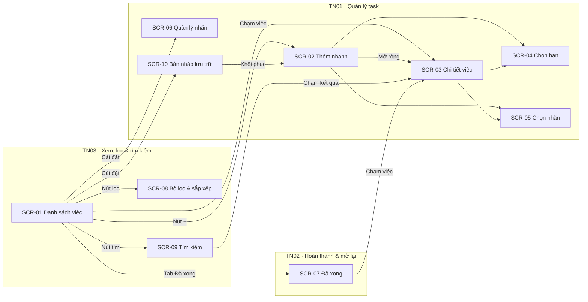

# Đề 1 · Quản lý công việc cá nhân

> **Mã:** DE01 · **Độ khó:** 1/8 · **Vai trò:** 1 (người dùng) · **Nền tảng:** App iOS / Android

App giúp một người ghi lại và hoàn thành việc cần làm hằng ngày. Dữ liệu lưu trên máy, không cần tài khoản, dùng offline. Đề gồm 3 tính năng; mỗi tính năng có 1 PRD và 1 SRS riêng.

## Tính năng

| **Mã** | **Tính năng** | **Phạm vi** | **PRD** | **SRS** |
| --- | --- | --- | --- | --- |
| TN01 | Quản lý task | Tạo nhanh; thêm hạn, ưu tiên, nhãn; sửa; xoá có hoàn tác; quản lý nhãn | [PRD](docs/TN01-quan-ly-task/PRD.md) | [SRS](docs/TN01-quan-ly-task/SRS.md) |
| TN02 | Hoàn thành & mở lại | Đánh dấu xong, hoàn tác, xem Đã xong, mở lại, dọn việc đã xong | [PRD](docs/TN02-hoan-thanh-mo-lai/PRD.md) | [SRS](docs/TN02-hoan-thanh-mo-lai/SRS.md) |
| TN03 | Xem, lọc & tìm kiếm | Hôm nay, Sắp tới, Tất cả; lọc theo nhãn và ưu tiên; sắp xếp; tìm kiếm | [PRD](docs/TN03-xem-loc-tim-kiem/PRD.md) | [SRS](docs/TN03-xem-loc-tim-kiem/SRS.md) |

Thứ tự làm gợi ý: TN01 → TN02 → TN03, vì TN02 và TN03 dùng dữ liệu và màn hình của TN01.

## Bản đồ tính năng và màn hình



## Bối cảnh chung

Người đi làm và sinh viên ghi việc rải rác ở ghi chú điện thoại, giấy nhớ, tin nhắn tự gửi. App phổ biến bắt tạo tài khoản và nặng tính năng làm việc nhóm. Đề này chỉ phục vụ một người trên một thiết bị, ưu tiên thao tác nhanh.

| **Nhóm người dùng** | **Nhu cầu chính** |
| --- | --- |
| Người đi làm văn phòng | Ghi nhanh việc phát sinh trong ngày, biết việc nào gấp |
| Sinh viên | Theo dõi hạn nộp bài, lịch thi |
| Freelancer | Tách việc của từng khách hàng bằng nhãn |

Ngoài phạm vi cả đề: tài khoản và đồng bộ, chia sẻ việc, việc lặp lại, thói quen, nhắc việc, việc con, đính kèm, bản Web.

## Quy ước dùng chung

- Mã BR và MSG đánh số liên tục trong cả đề để tham chiếu chéo không trùng: TN01 dùng BR-01–11, MSG-01–09; TN02 dùng BR-12–18, MSG-10–14; TN03 dùng BR-19–27, MSG-15–20. Mã bổ sung sau đánh tiếp từ số cuối: BR-28, MSG-21 (bản nháp lưu trữ) ở SRS TN01; BR-29 (thu gọn nhóm Quá hạn) ở SRS TN03.
- Trạng thái việc (`CHUA_XONG`, `QUA_HAN`, `DA_XONG`, `DANG_XOA`) định nghĩa ở [SRS TN01](docs/TN01-quan-ly-task/SRS.md), mục 4.1.
- Điều hướng: tab bar Hôm nay · Sắp tới · Tất cả · Đã xong; header có nút Tìm kiếm, Lọc, Cài đặt.

## Danh sách màn hình

| **Mã** | **Màn hình** | **Mô tả chi tiết ở** |
| --- | --- | --- |
| SCR-01 | Danh sách việc (Hôm nay, Sắp tới, Tất cả) | SRS TN03; dòng việc ở SRS TN02 |
| SCR-02 | Thêm nhanh | SRS TN01 |
| SCR-03 | Chi tiết việc | SRS TN01 |
| SCR-04 | Chọn hạn | SRS TN01 |
| SCR-05 | Chọn nhãn | SRS TN01 |
| SCR-06 | Quản lý nhãn | SRS TN01 |
| SCR-07 | Đã xong | SRS TN02 |
| SCR-08 | Bộ lọc & sắp xếp | SRS TN03 |
| SCR-09 | Tìm kiếm | SRS TN03 |
| SCR-10 | Bản nháp lưu trữ | SRS TN01 |

## Cấu trúc repo

```text
de01-quan-ly-cong-viec-ca-nhan/
├── README.md
└── docs/
    ├── TN01-quan-ly-task/          PRD.md · SRS.md
    ├── TN02-hoan-thanh-mo-lai/     PRD.md · SRS.md
    └── TN03-xem-loc-tim-kiem/      PRD.md · SRS.md
```

## Cách dùng bộ tài liệu

1. Đọc README để nắm phạm vi cả app và danh sách màn hình.
2. Với mỗi tính năng: đọc PRD (vì sao làm, cho ai, đo bằng gì), rồi SRS (quy tắc, trạng thái, use case, màn hình, thông báo).
3. Thiết kế màn hình theo đúng mã SCR, mã MSG trong SRS để dễ đối chiếu khi review.
4. Sơ đồ viết bằng Mermaid, xem trực tiếp trên GitHub hoặc trình xem Markdown có hỗ trợ Mermaid.
