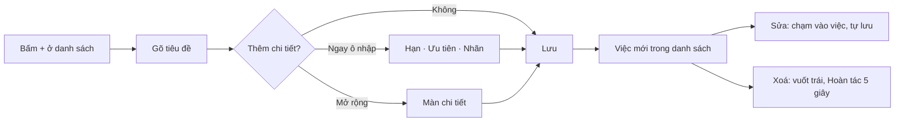

> **Mã:** DE01-TN01-PRD · **Trạng thái:** đã chốt · **Người viết:** Design · **SRS:** [SRS.md](SRS.md)

# PRD Quản lý task: tạo, sửa, xoá việc (App quản lý công việc cá nhân)

## 1. Bối cảnh và vấn đề

### 1.1 Bối cảnh

App quản lý công việc cá nhân lưu dữ liệu trên máy, không cần tài khoản (xem [README](../../README.md)). Ghi việc là thao tác người dùng làm nhiều nhất; nếu chậm hoặc rườm rà, họ quay lại ghi chú điện thoại. Tính năng này lo mọi thao tác tạo, sửa, xoá việc và quản lý nhãn.

### 1.2 Vấn đề

| **Vấn đề** | **Hệ quả** |
| --- | --- |
| Form tạo việc có nhiều trường phải điền | Mất nhiều bước cho một việc nhỏ, người dùng bỏ ghi |
| Việc không có hạn, không có mức ưu tiên | Việc gấp lẫn với việc không gấp |
| Không phân nhóm được việc (công việc, học, cá nhân) | Danh sách lẫn lộn, khó nhìn |
| Xoá nhầm là mất luôn | Người dùng ngại xoá, danh sách đầy việc thừa |
| Sửa xong quên bấm Lưu | Mất nội dung vừa sửa |

### 1.3 Mục tiêu

- Tạo một việc trong ≤ 5 giây kể từ khi bấm "+".
- ≥ 50% việc có ít nhất một chi tiết: hạn, ưu tiên hoặc nhãn.
- Không có trường hợp mất việc do xoá nhầm hay quên lưu.

## 2. Người dùng

| **Nhóm** | **Nhu cầu với tính năng này** |
| --- | --- |
| Người đi làm văn phòng | Ghi nhanh việc giữa cuộc họp, gán hạn và ưu tiên sau |
| Sinh viên | Đặt hạn nộp bài có giờ cụ thể |
| Freelancer | Gắn nhãn theo khách hàng để tách việc |

## 3. Phạm vi

### 3.1 Trong phạm vi (MVP)

- Ô thêm nhanh: tiêu đề, kèm nút gán hạn, ưu tiên, nhãn ngay trên ô nhập.
- Màn chi tiết: sửa tiêu đề, ghi chú, hạn, ưu tiên, nhãn; tự lưu.
- Xoá việc bằng vuốt trái hoặc menu, có Hoàn tác 5 giây.
- Nhãn: tạo ngay khi gán, đổi tên và xoá trong Cài đặt → Nhãn.
- Giá trị mặc định theo danh sách đang mở.

### 3.2 Ngoài phạm vi

- Nhập việc bằng giọng nói, tự nhận diện ngày giờ từ câu chữ ("mai 9h họp") → phase sau.
- Màu và biểu tượng cho nhãn.
- Việc con, file đính kèm, việc lặp lại, nhắc việc.
- Nhân bản việc, sửa hoặc xoá hàng loạt.

## 4. Nguyên tắc sản phẩm

### 4.1 Ghi trước, chi tiết sau

Chỉ tiêu đề là bắt buộc. Mọi chi tiết khác thêm lúc nào cũng được, không chặn nút Lưu.

### 4.2 Mặc định theo ngữ cảnh

Tạo từ đâu thì điền sẵn theo đó: từ Hôm nay thì hạn là hôm nay, đang lọc theo đúng một nhãn thì gán sẵn nhãn đó. Người dùng ít phải chọn hơn.

### 4.3 Không có nút Lưu ở màn chi tiết

Sửa đến đâu lưu đến đó; người dùng không bao giờ mất nội dung vì quên lưu.

### 4.4 Hoàn tác thay cho hỏi xác nhận

Xoá một việc không hỏi "Bạn có chắc?" mà có Hoàn tác 5 giây. Chỉ hỏi xác nhận khi thao tác ảnh hưởng nhiều việc, ví dụ xoá nhãn.

## 5. Quy tắc nghiệp vụ

| **Quy tắc** | **Giá trị** |
| --- | --- |
| Tiêu đề | Bắt buộc, 1–200 ký tự sau khi bỏ khoảng trắng đầu và cuối |
| Ghi chú | Không bắt buộc, tối đa 2.000 ký tự |
| Hạn | Ngày, giờ tuỳ chọn; không có giờ → hạn đến 23:59; cho chọn ngày đã qua |
| Ưu tiên | Cao, Trung bình, Thấp, Không; mặc định Không |
| Nhãn | Tối đa 3 nhãn mỗi việc, 20 nhãn trong app; tên 1–20 ký tự, không trùng |
| Mặc định khi tạo | Hôm nay → hạn hôm nay; Sắp tới → hạn ngày mai; Tất cả → không hạn; đang lọc đúng một nhãn → gán sẵn nhãn đó; đang lọc nhiều nhãn → không gán sẵn |
| Tự lưu | 500 ms sau lần gõ cuối, hoặc khi rời trường |
| Hoàn tác xoá | 5 giây |

- Các giới hạn trên là **cấu hình**, không cố định trong code.

## 6. Luồng trải nghiệm

| **Bước** | **Giai đoạn** | **Trải nghiệm** | **Đầu ra** |
| --- | --- | --- | --- |
| 1 | Mở ô nhập | Bấm "+" ở bất kỳ danh sách nào; bàn phím bật sẵn, giá trị mặc định điền theo danh sách | Ô nhập sẵn sàng |
| 2 | Gõ tiêu đề | Nút Lưu bật khi tiêu đề hợp lệ | Tiêu đề hợp lệ |
| 3 | Thêm chi tiết (tuỳ chọn) | Chạm biểu tượng lịch, cờ, nhãn ngay trên ô nhập; hoặc "Mở rộng" sang màn chi tiết | Hạn, ưu tiên, nhãn |
| 4 | Lưu | Bấm Lưu hoặc Xong; ô nhập trống lại để ghi việc tiếp | Việc mới trong danh sách |
| 5 | Sửa | Chạm vào việc → màn chi tiết; sửa đến đâu tự lưu đến đó | Việc được cập nhật |
| 6 | Xoá | Vuốt trái hoặc menu ⋯ → Xoá; Hoàn tác trong 5 giây | Việc bị xoá |
| 7 | Quản lý nhãn | Cài đặt → Nhãn: đổi tên, xoá | Bộ nhãn gọn gàng |

## 7. Use Cases, User Stories và Acceptance Criteria

### UC1. Ghi nhanh một việc

#### US1.1 Ghi việc chỉ bằng tiêu đề

User Story: Là người dùng, tôi muốn ghi một việc chỉ với tiêu đề để không quên khi đang bận.

AC01: Nút "+" luôn hiện ở Hôm nay, Sắp tới, Tất cả; bấm vào mở ô nhập với bàn phím bật sẵn.

AC02: Chỉ tiêu đề bắt buộc; lưu bằng nút Lưu hoặc phím Xong trên bàn phím.

AC03: Giá trị mặc định điền theo danh sách đang mở (mục 5) và hiện thành chip, bỏ được bằng ✕.

AC04: Lưu xong, ô nhập vẫn mở và trống để ghi việc tiếp theo.

AC05: Đóng ô nhập khi đã gõ chữ → giữ bản nháp cho lần mở sau.

AC06: Việc vừa tạo không thuộc danh sách đang xem (ví dụ hạn tuần sau khi đang ở Hôm nay) → báo đã thêm vào danh sách nào, có nút Xem.

#### US1.2 Thêm chi tiết khi tạo

User Story: Là người dùng, tôi muốn đặt hạn, ưu tiên, nhãn ngay lúc ghi việc để biết việc nào gấp và thuộc nhóm nào.

AC01: Trong ô nhập có nút chọn hạn, ưu tiên, nhãn; chọn xong quay lại ô nhập, bàn phím vẫn giữ.

AC02: Chọn hạn có lối tắt Hôm nay, Ngày mai, Cuối tuần, Tuần sau và lịch tháng; giờ là tuỳ chọn.

AC03: Gán nhãn chưa có → tạo luôn tại chỗ, không phải vào màn quản lý nhãn.

AC04: "Mở rộng" chuyển sang màn chi tiết, mang theo mọi thứ đã nhập. Đã có tên việc hợp lệ → việc được tạo ngay; chưa có → việc chỉ được tạo khi người dùng nhập tên hợp lệ ở màn chi tiết, rời màn khi tên còn trống thì không tạo việc và phần đã nhập được giữ làm bản nháp.

### UC2. Sửa việc

#### US2.1 Sửa nội dung việc

User Story: Là người dùng, tôi muốn sửa việc khi kế hoạch thay đổi mà không sợ mất nội dung.

AC01: Chạm vào việc mở màn chi tiết; sửa được mọi trường.

AC02: Tự lưu, không có nút Lưu; thời điểm sửa gần nhất hiện ở cuối màn.

AC03: Xoá trống tiêu đề rồi rời màn → giữ tiêu đề cũ và báo cho người dùng.

AC04: Đổi hạn làm việc rời danh sách đang xem → quay về danh sách thì việc không còn ở đó, có thông báo việc đã chuyển sang đâu.

### UC3. Xoá việc

#### US3.1 Xoá và hoàn tác

User Story: Là người dùng, tôi muốn xoá việc thừa và lấy lại được nếu xoá nhầm.

AC01: Xoá bằng vuốt trái trên danh sách hoặc menu ⋯ ở màn chi tiết.

AC02: Xoá xong hiện "Đã xoá" kèm Hoàn tác trong 5 giây; hết 5 giây thì xoá vĩnh viễn.

AC03: Không hỏi xác nhận khi xoá một việc.

AC04: Hoàn tác đưa việc về đúng vị trí cũ, giữ nguyên mọi chi tiết.

### UC4. Quản lý nhãn

#### US4.1 Đổi tên và xoá nhãn

User Story: Là người dùng, tôi muốn đổi tên và xoá nhãn để giữ hệ thống nhãn gọn gàng.

AC01: Cài đặt → Nhãn liệt kê mọi nhãn kèm số việc đang gắn.

AC02: Đổi tên ngay trên danh sách; tên trùng thì báo lỗi, không lưu.

AC03: Xoá nhãn chỉ gỡ nhãn khỏi các việc, không xoá việc; hỏi xác nhận kèm số việc bị ảnh hưởng.

## 8. Chỉ số theo dõi

| **Chỉ số** | **Định nghĩa** | **Mục tiêu MVP** |
| --- | --- | --- |
| Thời gian tạo việc | Từ lúc bấm "+" đến lúc lưu | ≤ 5 giây (trung vị) |
| Tỉ lệ việc có chi tiết | Việc có hạn, ưu tiên hoặc nhãn / tổng việc tạo | ≥ 50% |
| Tỉ lệ tạo liên tiếp | Phiên mở ô nhập tạo ≥ 2 việc / tổng phiên mở ô nhập | Theo dõi |
| Tỉ lệ dùng Mở rộng | Lượt tạo qua màn chi tiết / tổng lượt tạo | Theo dõi; cao là dấu hiệu ô nhập nhanh thiếu thứ gì đó |
| Tỉ lệ hoàn tác xoá | Lượt hoàn tác / lượt xoá | ≤ 10%; cao là dấu hiệu vuốt nhầm |
| Số nhãn trung bình | Nhãn mỗi người dùng hoạt động | Theo dõi |

## 9. Phụ thuộc và rủi ro

| **Mục** | **Mô tả** | **Hướng xử lý** |
| --- | --- | --- |
| Vuốt nhầm | Vuốt trái để xoá dễ nhầm với cuộn | Ngưỡng vuốt đủ dài, Hoàn tác 5 giây |
| Tự lưu khi app bị tắt đột ngột | Mất nội dung vừa gõ | Lưu ngay khi app chuyển xuống nền |
| Bản nháp ô nhập | Người dùng quên có bản nháp, thấy chữ lạ khi mở lại | Hiện nhãn "Bản nháp" nhỏ trong ô nhập |
| Giới hạn 20 nhãn | Freelancer nhiều khách có thể thiếu | Theo dõi số nhãn, nới giới hạn nếu cần |
| Hạn ở ngày đã qua | Người dùng chọn nhầm ngày cũ | Cho phép nhưng ghi chú "Việc sẽ hiện là quá hạn" khi chọn |

## 10. Câu hỏi mở

> Mọi câu hỏi dưới đây đã được PO chốt ngày 13/11/2026; quyết định ghi sau mỗi câu và đã cập nhật vào SRS.

- Tạo việc từ Hôm nay có tự gán hạn hôm nay không, hay để trống? → **Đã chốt:** Có, tự gán hạn hôm nay (SRS BR-06).
- Có cho chọn ngày đã qua làm hạn không? → **Đã chốt:** Có, kèm ghi chú "Việc sẽ hiện là quá hạn" (SRS BR-03).
- Giới hạn 3 nhãn mỗi việc và 20 nhãn trong app có đủ không? → **Đã chốt:** Giữ 3 nhãn mỗi việc, 20 nhãn trong app; là cấu hình, nới được sau (SRS BR-05).
- Nhãn có cần màu ở MVP không, hay để phase sau? → **Đã chốt:** Có màu ở MVP, bảng 12 màu (SRS BR-05).
- Bản nháp ô nhập giữ trong bao lâu? → **Đã chốt:** Tự điền lại trong 12 giờ, sau đó chuyển vào Bản nháp lưu trữ (SRS BR-28).
