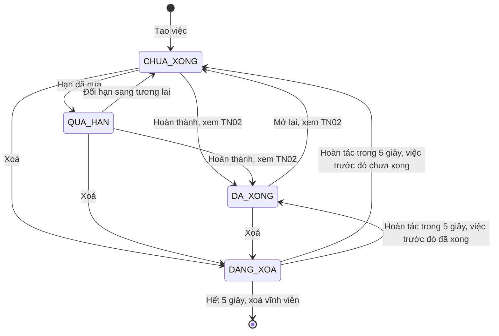
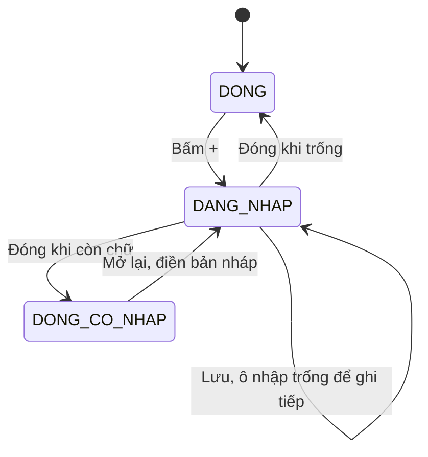
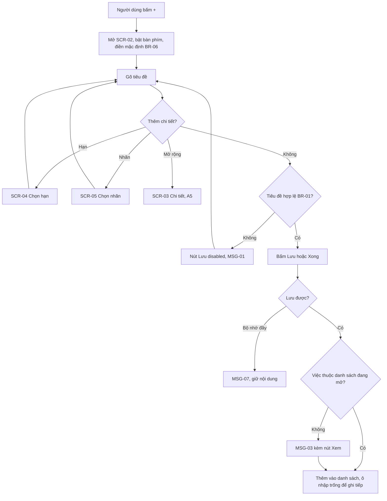
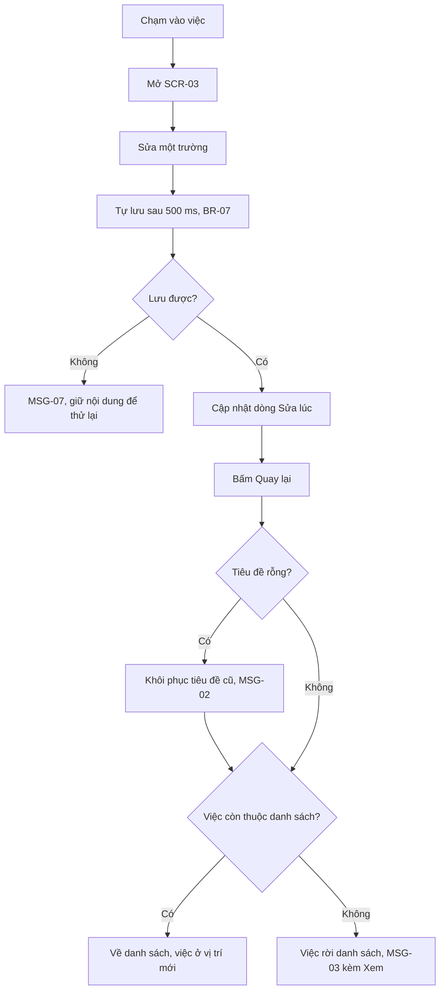
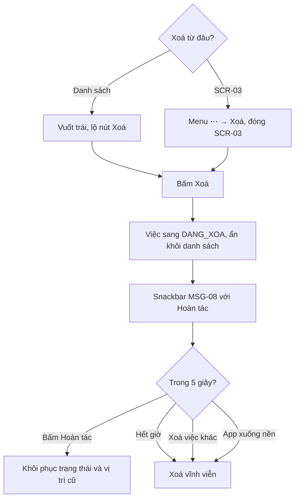
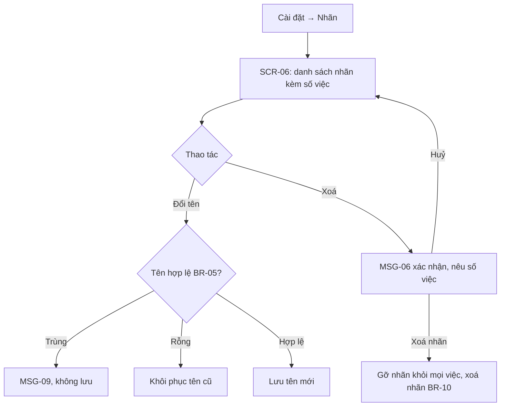
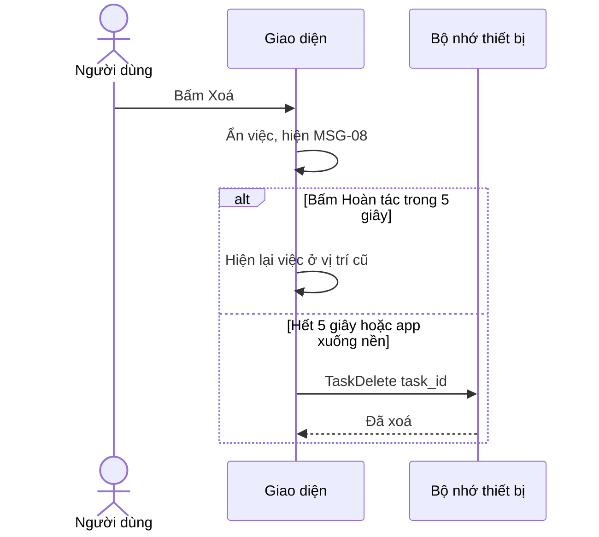

> **Mã:** DE01-TN01-SRS · **Trạng thái:** nháp · **Người viết:** Design (mock) · **PRD:** [PRD.md](PRD.md)

# UC-DE01-01 - Quản lý task: tạo, sửa, xoá

> **Bản mock.** Giá trị `[giả định]` cần BA xác nhận. SRS này mô tả tạo, sửa, xoá việc và quản lý nhãn; hoàn thành việc xem [SRS TN02](../TN02-hoan-thanh-mo-lai/SRS.md); danh sách và tìm kiếm xem [SRS TN03](../TN03-xem-loc-tim-kiem/SRS.md).

## 1. Tổng quan

| **Mục** | **Nội dung** |
| --- | --- |
| Mục tiêu | Người dùng ghi nhanh việc cần làm, thêm hạn, ưu tiên, nhãn; sửa và xoá việc; quản lý nhãn |
| Actor | Người dùng · Hệ thống (app và bộ nhớ trên thiết bị) |
| Phạm vi | Tạo, sửa, xoá việc; tạo, đổi tên, xoá nhãn |
| Ngoài phạm vi | Đồng bộ, chia sẻ, việc lặp lại, việc con, đính kèm, nhắc việc |
| Nền tảng | App iOS / Android `[giả định]` |
| Figma | `[chưa có]` |

## 2. User Story

| **ID** | **As a** | **I want** | **So that** |
| --- | --- | --- | --- |
| US-01 | Người dùng | Ghi việc chỉ bằng tiêu đề | Không quên việc khi đang bận |
| US-02 | Người dùng | Đặt hạn, ưu tiên, nhãn cho việc | Biết việc nào gấp, việc thuộc nhóm nào |
| US-03 | Người dùng | Sửa nội dung việc | Cập nhật khi kế hoạch thay đổi |
| US-04 | Người dùng | Xoá việc và hoàn tác khi xoá nhầm | Danh sách gọn mà không sợ mất việc |
| US-05 | Người dùng | Đổi tên, xoá nhãn | Giữ hệ thống nhãn gọn gàng |

## 3. Business Rules

Mã BR đánh số liên tục trong cả đề 1 (SRS TN02 tiếp từ BR-12, SRS TN03 tiếp từ BR-19).

| **Mã** | **Quy tắc** |
| --- | --- |
| BR-01 | **Tiêu đề** bắt buộc, 1–200 ký tự sau khi bỏ khoảng trắng đầu và cuối; chỉ có khoảng trắng → coi là rỗng `[giả định]` |
| BR-02 | **Ghi chú** tối đa 2.000 ký tự; đủ giới hạn → không nhập thêm được, bộ đếm chuyển đỏ `[giả định]` |
| BR-03 | **Hạn** gồm ngày (bắt buộc khi đặt hạn) và giờ (tuỳ chọn). Không có giờ → hạn tính đến 23:59 ngày đó. Cho chọn ngày đã qua; việc tạo ra sẽ ở trạng thái quá hạn |
| BR-04 | **Ưu tiên**: Cao, Trung bình, Thấp, Không; mặc định Không |
| BR-05 | **Nhãn**: tối đa 3 nhãn mỗi việc, 20 nhãn trong app; tên 1–20 ký tự, không trùng (không phân biệt hoa thường) `[giả định]` |
| BR-06 | **Giá trị mặc định khi tạo** theo danh sách đang mở: Hôm nay → hạn hôm nay; Sắp tới → hạn ngày mai; Tất cả → không hạn; đang lọc theo nhãn → gán sẵn nhãn đó `[giả định]` |
| BR-07 | Sửa ở màn chi tiết **tự lưu** 500 ms sau lần gõ cuối hoặc khi rời trường `[giả định]`; không có nút Lưu |
| BR-08 | Tiêu đề bị xoá rỗng khi rời màn chi tiết → khôi phục tiêu đề trước đó, hiện MSG-02 |
| BR-09 | **Xoá việc**: ẩn ngay, Hoàn tác trong 5 giây. Xoá vĩnh viễn khi hết 5 giây, khi có thao tác xoá khác, hoặc khi app chuyển xuống nền `[giả định]` |
| BR-10 | **Xoá nhãn**: gỡ nhãn khỏi mọi việc, không xoá việc; phải xác nhận (MSG-06) |
| BR-11 | Mọi mốc giờ theo múi giờ thiết bị; mỗi việc lưu thời điểm tạo và sửa gần nhất |

## 4. Trạng thái

### 4.1 Trạng thái việc (dùng chung cho cả đề 1)

| **Trạng thái** | **Điều kiện** | **Hiển thị** |
| --- | --- | --- |
| `CHUA_XONG` | Mặc định khi tạo, hoặc mở lại từ Đã xong | Hiện trong Hôm nay / Sắp tới / Tất cả theo hạn |
| `QUA_HAN` | Suy ra: `CHUA_XONG` và hạn < hiện tại; không lưu riêng | Ngày hạn màu đỏ, nằm trong nhóm Quá hạn |
| `DA_XONG` | Người dùng đánh dấu hoàn thành ([SRS TN02](../TN02-hoan-thanh-mo-lai/SRS.md)) | Chỉ hiện trong Đã xong và kết quả tìm kiếm |
| `DANG_XOA` | Vừa bị xoá, còn trong 5 giây hoàn tác | Ẩn khỏi mọi danh sách; snackbar MSG-08 |

Hoàn tác từ `DANG_XOA` trả việc về đúng trạng thái trước khi xoá (`CHUA_XONG` hoặc `DA_XONG`).

### 4.2 Ô nhập nhanh

## 5. Use Case

### UC-01 Tạo việc

| **Mục** | **Nội dung** |
| --- | --- |
| Tiền điều kiện | App đang mở ở một danh sách: Hôm nay, Sắp tới hoặc Tất cả |
| Hậu điều kiện thành công | Việc mới lưu trên thiết bị, trạng thái `CHUA_XONG`, hiện đúng danh sách theo hạn |
| Hậu điều kiện thất bại | Không tạo việc; nội dung đã gõ được giữ lại |

**Luồng chính**

| **Bước** | **Actor** | **Mô tả** |
| --- | --- | --- |
| 1 | Người dùng | Bấm nút "+" |
| 2 | Hệ thống | Mở **SCR-02**, bật bàn phím, điền giá trị mặc định theo BR-06 thành chip |
| 3 | Người dùng | Gõ tiêu đề; tuỳ chọn chạm biểu tượng Hạn / Ưu tiên / Nhãn |
| 4 | Hệ thống | Kiểm tra BR-01; hợp lệ → bật nút Lưu |
| 5 | Người dùng | Bấm Lưu hoặc phím Xong |
| 6 | Hệ thống | Lưu việc; thêm vào danh sách đang mở nếu khớp; xoá trắng ô nhập, giữ **SCR-02** mở |
| 7 | Người dùng | Vuốt xuống hoặc chạm ra ngoài để đóng **SCR-02** |

**Luồng thay thế**

| **Mã** | **Điều kiện** | **Xử lý** |
| --- | --- | --- |
| A1 | Việc mới không thuộc danh sách đang mở | Bước 6 lưu bình thường, hiện MSG-03 kèm nút "Xem" mở danh sách chứa việc |
| A2 | Chạm biểu tượng Hạn | Mở **SCR-04**; chọn xong quay lại bước 3, bàn phím bật lại |
| A3 | Chạm biểu tượng Nhãn, gõ tên chưa có | **SCR-05** hiện dòng "Tạo nhãn '{tên}'"; chạm → tạo và gán luôn |
| A4 | Đóng **SCR-02** khi đã gõ chữ | Giữ bản nháp; lần mở sau điền lại, kèm nhãn "Bản nháp" |
| A5 | Chạm "Mở rộng" | Sang **SCR-03** với dữ liệu đã nhập; việc chỉ được tạo khi tiêu đề hợp lệ |

**Luồng lỗi**

| **Mã** | **Điều kiện** | **Xử lý** |
| --- | --- | --- |
| E1 | Tiêu đề rỗng hoặc chỉ có khoảng trắng | Nút Lưu disabled; bấm Xong trên bàn phím → rung nhẹ, hiện MSG-01 |
| E2 | Tiêu đề chạm 200 ký tự | Không nhập thêm được; bộ đếm chuyển đỏ |
| E3 | Việc đã có 3 nhãn | Các nhãn khác trong **SCR-05** disabled, hiện MSG-04 |
| E4 | App đã có 20 nhãn | Không hiện dòng tạo nhãn mới, hiện MSG-05 |
| E5 | Lưu thất bại do bộ nhớ đầy | Hiện MSG-07, giữ nội dung trong ô nhập |

### UC-02 Sửa việc

| **Mục** | **Nội dung** |
| --- | --- |
| Tiền điều kiện | Việc tồn tại, trạng thái `CHUA_XONG` hoặc `DA_XONG` |
| Hậu điều kiện thành công | Trường đã sửa được lưu; cập nhật thời điểm sửa |
| Hậu điều kiện thất bại | Giữ giá trị trước khi sửa |

**Luồng chính**

| **Bước** | **Actor** | **Mô tả** |
| --- | --- | --- |
| 1 | Người dùng | Chạm vào một việc trong danh sách |
| 2 | Hệ thống | Mở **SCR-03** với dữ liệu của việc |
| 3 | Người dùng | Sửa một hoặc nhiều trường |
| 4 | Hệ thống | Tự lưu theo BR-07; cập nhật dòng "Sửa lúc …" |
| 5 | Người dùng | Bấm Quay lại |
| 6 | Hệ thống | Về danh sách; việc nằm đúng vị trí mới theo cách sắp xếp |

**Luồng thay thế**

| **Mã** | **Điều kiện** | **Xử lý** |
| --- | --- | --- |
| A1 | Tiêu đề bị xoá trống khi rời màn | Khôi phục tiêu đề trước đó, hiện MSG-02 (BR-08) |
| A2 | Đổi hạn làm việc rời danh sách đang xem | Bước 6: việc không còn trong danh sách, hiện MSG-03 kèm "Xem" |
| A3 | Sửa việc `DA_XONG` | Cho sửa bình thường, không đổi trạng thái |

**Luồng lỗi**

| **Mã** | **Điều kiện** | **Xử lý** |
| --- | --- | --- |
| E1 | Lưu thất bại | Hiện MSG-07; trường đang sửa giữ nội dung để thử lại |

### UC-03 Xoá việc

| **Mục** | **Nội dung** |
| --- | --- |
| Tiền điều kiện | Việc tồn tại |
| Hậu điều kiện thành công | Việc bị xoá vĩnh viễn sau thời gian hoàn tác |
| Hậu điều kiện thất bại | Việc giữ nguyên |

**Luồng chính**

| **Bước** | **Actor** | **Mô tả** |
| --- | --- | --- |
| 1 | Người dùng | Vuốt trái trên dòng việc → lộ nút Xoá đỏ; hoặc ở **SCR-03** chọn menu ⋯ → Xoá |
| 2 | Người dùng | Bấm Xoá |
| 3 | Hệ thống | Chuyển việc sang `DANG_XOA`, ẩn khỏi danh sách, hiện snackbar MSG-08 với nút Hoàn tác |
| 4 | Hệ thống | Hết 5 giây → xoá vĩnh viễn (BR-09) |

**Luồng thay thế**

| **Mã** | **Điều kiện** | **Xử lý** |
| --- | --- | --- |
| A1 | Bấm Hoàn tác trong 5 giây | Khôi phục về trạng thái và vị trí cũ, ẩn snackbar |
| A2 | Xoá từ **SCR-03** | Đóng **SCR-03**, về danh sách rồi mới hiện snackbar |
| A3 | Xoá việc khác khi snackbar còn | Việc trước xoá vĩnh viễn; snackbar mới cho việc sau |
| A4 | App chuyển xuống nền trong 5 giây | Xoá vĩnh viễn ngay `[giả định]` |

### UC-04 Quản lý nhãn

| **Mục** | **Nội dung** |
| --- | --- |
| Tiền điều kiện | Có ít nhất 1 nhãn |
| Hậu điều kiện thành công | Nhãn được đổi tên hoặc xoá; việc liên quan cập nhật theo |
| Hậu điều kiện thất bại | Nhãn giữ nguyên |

**Luồng chính**

| **Bước** | **Actor** | **Mô tả** |
| --- | --- | --- |
| 1 | Người dùng | Cài đặt → Nhãn |
| 2 | Hệ thống | Mở **SCR-06**: danh sách nhãn, mỗi dòng kèm số việc đang gắn |
| 3 | Người dùng | Chạm tên để đổi tên, hoặc chạm biểu tượng xoá |
| 4 | Hệ thống | Đổi tên: kiểm tra BR-05 rồi lưu. Xoá: hiện MSG-06 xác nhận |
| 5 | Người dùng | Xác nhận xoá |
| 6 | Hệ thống | Gỡ nhãn khỏi mọi việc, xoá nhãn (BR-10) |

**Luồng lỗi**

| **Mã** | **Điều kiện** | **Xử lý** |
| --- | --- | --- |
| E1 | Tên mới trùng nhãn khác | Hiện MSG-09, không lưu |
| E2 | Tên mới rỗng | Khôi phục tên cũ khi rời ô |

## 6. Điểm vào

| **Điểm vào** | **Dẫn tới** | **Ghi chú** |
| --- | --- | --- |
| Nút "+" ở Hôm nay / Sắp tới / Tất cả | UC-01, **SCR-02** | Giá trị mặc định theo BR-06 |
| Nút "Thêm việc" ở màn trống | UC-01, **SCR-02** | Màn trống mô tả ở SRS TN03 |
| Chạm vào một việc | UC-02, **SCR-03** | Từ mọi danh sách và kết quả tìm kiếm |
| Vuốt trái trên dòng việc | UC-03 | |
| Menu ⋯ ở **SCR-03** | UC-03 | |
| Cài đặt → Nhãn | UC-04, **SCR-06** | |

## 7. Mô tả màn hình

### SCR-02 Thêm nhanh (bottom sheet)

| **#** | **Thành phần** | **Loại** | **Bắt buộc** | **Validate / hành vi** |
| --- | --- | --- | --- | --- |
| 1 | Tiêu đề | Text, tự xuống dòng | Có | BR-01; placeholder "Bạn cần làm gì?"; bộ đếm hiện khi ≥ 180 ký tự |
| 2 | Hạn | Icon lịch + chip | Không | Mở **SCR-04**; đã chọn → chip "Hôm nay 17:00" có ✕ |
| 3 | Ưu tiên | Icon cờ | Không | Menu 4 mức (BR-04); đã chọn → cờ đổi theo mức, kèm chữ |
| 4 | Nhãn | Icon thẻ + chip | Không | Mở **SCR-05**; chip nhãn đã gán, có ✕ |
| 5 | Mở rộng | Icon | – | Sang **SCR-03**, mang theo dữ liệu đã nhập |
| 6 | Nhãn "Bản nháp" | Text phụ | – | Chỉ hiện khi đang điền lại bản nháp |
| 7 | Nút Lưu | Button | – | Disabled đến khi BR-01 hợp lệ |

### SCR-03 Chi tiết việc

| **#** | **Thành phần** | **Loại** | **Bắt buộc** | **Validate / hành vi** |
| --- | --- | --- | --- | --- |
| 1 | Ô tròn hoàn thành | Checkbox | – | Hành vi ở SRS TN02 |
| 2 | Tiêu đề | Text nhiều dòng | Có | BR-01, BR-07, BR-08 |
| 3 | Ghi chú | Text nhiều dòng | Không | BR-02; placeholder "Thêm ghi chú" |
| 4 | Hạn | Dòng chọn | Không | Mở **SCR-04**; trống → "Thêm hạn" |
| 5 | Ưu tiên | Dòng chọn | Không | 4 mức |
| 6 | Nhãn | Dòng chip | Không | Mở **SCR-05** |
| 7 | Thông tin | Text phụ | – | "Tạo lúc {ngày giờ} · Sửa lúc {ngày giờ}" |
| 8 | Menu ⋯ | Menu | – | Xoá (UC-03) |

### SCR-04 Chọn hạn (bottom sheet)

| **#** | **Thành phần** | **Loại** | **Hành vi** |
| --- | --- | --- | --- |
| 1 | Lối tắt | Chips | Hôm nay, Ngày mai, Cuối tuần (thứ Bảy), Tuần sau (thứ Hai) `[giả định]` |
| 2 | Lịch tháng | Calendar | Chọn ngày bất kỳ; ngày đã qua chọn được, hiện ghi chú "Việc sẽ hiện là quá hạn" |
| 3 | Thêm giờ | Toggle + time picker | Tắt mặc định; bật mới hiện chọn giờ |
| 4 | Bỏ hạn | Button text | Xoá hạn, chỉ hiện khi việc đang có hạn |
| 5 | Xong | Button | Áp dụng và đóng |

### SCR-05 Chọn nhãn (bottom sheet)

| **#** | **Thành phần** | **Loại** | **Hành vi** |
| --- | --- | --- | --- |
| 1 | Ô tìm / tạo nhãn | Text | Gõ để lọc; không khớp nhãn nào → dòng "Tạo nhãn '{tên}'" |
| 2 | Danh sách nhãn | Checkbox list | Chọn tối đa 3 (BR-05); đủ 3 → các nhãn còn lại disabled, MSG-04 |
| 3 | Xong | Button | Áp dụng và đóng |

### SCR-06 Quản lý nhãn

| **#** | **Thành phần** | **Loại** | **Hành vi** |
| --- | --- | --- | --- |
| 1 | Danh sách nhãn | List | Tên + "{n} việc"; sắp theo tên |
| 2 | Đổi tên | Inline edit | BR-05; trùng → MSG-09 |
| 3 | Xoá | Icon | MSG-06 xác nhận |
| 4 | Màn trống | Empty state | "Chưa có nhãn. Nhãn được tạo khi bạn gán cho việc" |

### Snackbar hoàn tác (dùng chung cả app)

Nằm phía trên nút "+", hiện 5 giây; gồm nội dung và nút "Hoàn tác". Mỗi lúc chỉ có một snackbar, snackbar mới thay snackbar cũ.

## 8. Dữ liệu và thao tác

App lưu dữ liệu trên thiết bị, không gọi API. Bảng dưới mô tả thao tác dữ liệu, thay cho mục API ở các đề có máy chủ.

| **Thao tác** | **Input chính** | **Output chính** | **Ghi chú** |
| --- | --- | --- | --- |
| \[TaskCreate\] | title, note, due_date, due_time, priority, label_ids | task_id, created_at | Kiểm tra BR-01–05 |
| \[TaskUpdate\] | task_id, các trường thay đổi | updated_at | Gọi theo BR-07 |
| \[TaskDelete\] | task_id | – | Chỉ gọi khi hết thời gian hoàn tác (BR-09) |
| \[LabelCreate\] | name | label_id | BR-05 |
| \[LabelUpdate\] | label_id, name | – | BR-05 |
| \[LabelDelete\] | label_id | Số việc bị gỡ nhãn | BR-10 |

**Mô hình dữ liệu**

| **Đối tượng** | **Trường** |
| --- | --- |
| Task | id, title, note, due_date (có thể rỗng), due_time (có thể rỗng), priority (NONE, LOW, MEDIUM, HIGH), label_ids (≤ 3), status (OPEN, DONE), completed_at, created_at, updated_at |
| Label | id, name, created_at |
| Draft | title, due_date, due_time, priority, label_ids (bản nháp ô nhập, tối đa 1) |

## 9. Danh sách thông báo

| **ID** | **Nơi hiện** | **Nội dung (VI)** |
| --- | --- | --- |
| MSG-01 | Inline dưới tiêu đề | Vui lòng nhập tên công việc |
| MSG-02 | Toast | Tên công việc không được để trống, đã giữ tên cũ |
| MSG-03 | Toast | Đã thêm vào {Hôm nay / Sắp tới / Tất cả} · Xem |
| MSG-04 | Inline **SCR-05** | Mỗi việc có tối đa 3 nhãn |
| MSG-05 | Inline **SCR-05** | Bạn đã có 20 nhãn. Xoá bớt nhãn để tạo nhãn mới |
| MSG-06 | Popup | Xoá nhãn "{tên}"? Nhãn sẽ được gỡ khỏi {n} việc, các việc vẫn được giữ. \[Huỷ\] \[Xoá nhãn\] |
| MSG-07 | Popup | Không lưu được vì bộ nhớ thiết bị đã đầy. Vui lòng giải phóng dung lượng rồi thử lại |
| MSG-08 | Snackbar | Đã xoá "{tiêu đề, rút gọn 30 ký tự}" · Hoàn tác |
| MSG-09 | Inline | Nhãn này đã có |

Bản EN: `[chờ bổ sung]`.

## 10. Yêu cầu phi chức năng

| **Mục** | **Yêu cầu** `[giả định]` |
| --- | --- |
| Hiệu năng | Mở **SCR-02** ≤ 300 ms sau khi bấm "+"; lưu việc phản hồi ≤ 100 ms với 2.000 việc |
| Offline | Toàn bộ chức năng chạy không cần mạng |
| Dữ liệu | Không mất dữ liệu khi app bị tắt đột ngột hoặc khi cập nhật phiên bản app; lưu ngay khi app xuống nền |
| Quyền riêng tư | Không gửi tiêu đề, ghi chú, tên nhãn ra ngoài; analytics chỉ gửi sự kiện |
| Tracking | Tạo việc (nguồn: thêm nhanh / mở rộng; có hạn / ưu tiên / nhãn), sửa, xoá, hoàn tác xoá, tạo / đổi tên / xoá nhãn |
| Accessibility | Nút có nhãn cho trình đọc màn hình; mức ưu tiên không chỉ phân biệt bằng màu; vùng chạm ≥ 44 pt; hỗ trợ cỡ chữ hệ thống; xoá có thao tác thay thế cho vuốt |
