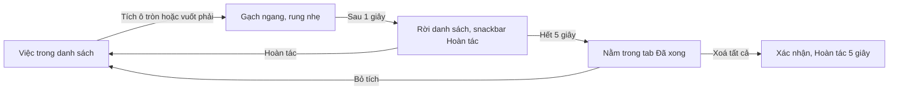

> **Mã:** DE01-TN02-PRD · **Trạng thái:** nháp · **Người viết:** Design (mock) · **SRS:** [SRS.md](SRS.md)

# PRD Hoàn thành và mở lại việc (App quản lý công việc cá nhân)

> **Bản mock.** Con số đánh dấu `[giả định]` dùng để dựng flow, cần PO xác nhận trước khi dùng.

## 1. Bối cảnh và vấn đề

### 1.1 Bối cảnh

Sau khi ghi việc ([TN01](../TN01-quan-ly-task/PRD.md)), thao tác tiếp theo người dùng làm nhiều nhất là đánh dấu xong. Cảm giác "gạch được một việc" là lý do chính khiến người dùng quay lại app mỗi ngày. Tính năng này lo việc đánh dấu hoàn thành, lấy lại khi bấm nhầm, xem lại việc đã làm và dọn danh sách đã xong.

### 1.2 Vấn đề

| **Vấn đề** | **Hệ quả** |
| --- | --- |
| Đánh dấu xong phải mở từng việc | Người dùng lười cập nhật, danh sách không phản ánh thực tế |
| Tích nhầm thì việc biến mất, khó tìm lại | Người dùng mất việc chưa làm, mất niềm tin vào app |
| Việc đã xong vẫn lẫn trong danh sách đang làm | Danh sách dài, khó thấy việc còn lại |
| Không xem lại được hôm qua đã làm những gì | Không có cảm giác tiến bộ, khó báo cáo công việc |
| Danh sách đã xong phình to theo thời gian | App chậm, khó tìm việc cũ |

### 1.3 Mục tiêu

- Đánh dấu xong bằng 1 chạm hoặc 1 lần vuốt, ngay trên danh sách.
- Lấy lại việc tích nhầm bằng ≤ 1 chạm.
- Tỉ lệ việc được hoàn thành trong 7 ngày ≥ 40% `[giả định]`.

## 2. Người dùng

| **Nhóm** | **Nhu cầu với tính năng này** |
| --- | --- |
| Người đi làm văn phòng | Gạch nhanh việc trong ngày; cuối tuần xem lại đã làm gì để báo cáo |
| Sinh viên | Đánh dấu bài đã nộp, mở lại khi phải nộp bổ sung |
| Freelancer | Xem việc đã xong theo ngày để tính công cho khách |

## 3. Phạm vi

### 3.1 Trong phạm vi (MVP)

- Đánh dấu xong bằng ô tròn trên dòng việc, vuốt phải, hoặc ô tròn ở màn chi tiết.
- Hoàn tác trong 5 giây sau khi đánh dấu xong.
- Tab Đã xong: việc đã hoàn thành nhóm theo ngày.
- Mở lại việc đã xong.
- Xoá tất cả việc đã xong, có xác nhận và Hoàn tác.

### 3.2 Ngoài phạm vi

- Thống kê năng suất, biểu đồ, streak → phase sau.
- Hiệu ứng chúc mừng mỗi lần hoàn thành.
- Tự động dọn việc đã xong sau N ngày.
- Đánh dấu xong hàng loạt.

## 4. Nguyên tắc sản phẩm

### 4.1 Một chạm là xong

Không mở màn mới, không hỏi xác nhận. Ô tròn có vùng chạm đủ lớn để bấm bằng một tay.

### 4.2 Phản hồi rõ ràng

Tích xong thấy ngay: ô tròn đầy, tiêu đề gạch ngang, rung nhẹ, rồi việc rời danh sách sau 1 giây `[giả định]`. Người dùng biết chắc thao tác đã ăn.

### 4.3 Lấy lại dễ dàng

Hoàn tác ngay trong 5 giây; quá giờ thì mở lại từ tab Đã xong. Không có cách nào làm mất một việc chỉ vì tích nhầm.

### 4.4 Không làm phiền

Không popup, không âm thanh mặc định. Chỉ khi xong hết việc hôm nay mới có màn trống chúc mừng (mô tả ở [TN03](../TN03-xem-loc-tim-kiem/PRD.md)).

## 5. Quy tắc nghiệp vụ

| **Quy tắc** | **Giá trị** `[giả định]` |
| --- | --- |
| Ngưỡng vuốt phải để hoàn thành | 40% chiều rộng dòng việc |
| Thời gian giữ việc trên danh sách sau khi tích | 1 giây; tích lại trong thời gian này là huỷ |
| Hoàn tác | 5 giây sau khi việc rời danh sách |
| Nhóm trong Đã xong | Theo ngày hoàn thành: Hôm nay, Hôm qua, {thứ, ngày} |
| Mở lại | Giữ nguyên hạn, ưu tiên, nhãn; hạn đã qua thì hiện là quá hạn |
| Xoá tất cả việc đã xong | Có xác nhận kèm số lượng, Hoàn tác 5 giây |

- Các giá trị trên là **cấu hình**, không cố định trong code.

## 6. Luồng trải nghiệm

| **Bước** | **Giai đoạn** | **Trải nghiệm** | **Đầu ra** |
| --- | --- | --- | --- |
| 1 | Làm xong việc | Tích ô tròn hoặc vuốt phải trên dòng việc | Việc gạch ngang |
| 2 | Xác nhận bằng mắt | Việc rời danh sách sau 1 giây; snackbar "Đã hoàn thành · Hoàn tác" | Việc `DA_XONG` |
| 3 | Tích nhầm | Bấm Hoàn tác trong 5 giây, hoặc tích lại trong 1 giây đầu | Việc về như cũ |
| 4 | Xem lại | Tab Đã xong, nhóm theo ngày | Biết đã làm gì |
| 5 | Mở lại | Bỏ tích việc trong Đã xong | Việc quay lại danh sách |
| 6 | Dọn dẹp | Menu ⋯ → Xoá tất cả việc đã xong | Tab Đã xong trống |

## 7. Use Cases, User Stories và Acceptance Criteria

### UC1. Đánh dấu hoàn thành

#### US1.1 Đánh dấu xong ngay trên danh sách

User Story: Là người dùng, tôi muốn đánh dấu xong ngay trên danh sách để thấy mình tiến bộ và danh sách gọn lại.

AC01: Ô tròn hiện ở mọi dòng việc trong Hôm nay, Sắp tới, Tất cả và kết quả tìm kiếm.

AC02: Tích ô tròn hoặc vuốt phải quá ngưỡng → tiêu đề gạch ngang, rung nhẹ, việc rời danh sách sau 1 giây.

AC03: Tích lại trong 1 giây đầu → huỷ, việc giữ nguyên, không hiện snackbar.

AC04: Việc rời danh sách → snackbar "Đã hoàn thành" kèm Hoàn tác trong 5 giây.

#### US1.2 Đánh dấu xong ở màn chi tiết

User Story: Là người dùng, tôi muốn đánh dấu xong ngay ở màn chi tiết để không phải quay lại danh sách.

AC01: Ô tròn ở màn chi tiết hoạt động như trên danh sách, nhưng người dùng vẫn ở lại màn chi tiết.

AC02: Màn chi tiết hiện "Đã hoàn thành lúc {giờ}" ngay dưới tiêu đề.

### UC2. Xem và mở lại việc đã xong

#### US2.1 Xem việc đã làm

User Story: Là người dùng, tôi muốn xem lại việc đã làm theo ngày để biết mình đã làm được gì.

AC01: Tab Đã xong nhóm theo ngày hoàn thành, mới nhất ở trên; mỗi nhóm có số lượng.

AC02: Mỗi dòng có ô tròn đầy, tiêu đề gạch ngang màu nhạt, giờ hoàn thành.

AC03: Chưa có việc nào xong → màn trống giải thích việc xong sẽ hiện ở đây.

#### US2.2 Mở lại việc

User Story: Là người dùng, tôi muốn mở lại việc chưa thật sự xong để tiếp tục theo dõi việc đó.

AC01: Bỏ tích ô tròn → việc về `CHUA_XONG`, rời tab Đã xong, báo đã chuyển về danh sách nào.

AC02: Hạn, ưu tiên, nhãn giữ nguyên; hạn đã qua thì việc hiện ở nhóm Quá hạn.

### UC3. Dọn việc đã xong

#### US3.1 Xoá tất cả việc đã xong

User Story: Là người dùng, tôi muốn xoá hàng loạt việc đã xong để dọn danh sách cũ.

AC01: Menu ⋯ ở tab Đã xong có "Xoá tất cả việc đã xong", chỉ bật khi có ít nhất 1 việc.

AC02: Hỏi xác nhận kèm số việc; xác nhận xong có Hoàn tác 5 giây.

AC03: Xoá một việc đã xong bằng vuốt trái như ở [TN01](../TN01-quan-ly-task/PRD.md).

## 8. Chỉ số theo dõi `[giả định]`

| **Chỉ số** | **Định nghĩa** | **Mục tiêu MVP** |
| --- | --- | --- |
| Tỉ lệ hoàn thành | Việc hoàn thành / việc tạo trong 7 ngày | ≥ 40% |
| Tỉ lệ hoàn tác hoàn thành | Lượt hoàn tác / lượt hoàn thành | ≤ 5%; cao là dấu hiệu dễ tích nhầm |
| Tỉ lệ dùng vuốt | Lượt hoàn thành bằng vuốt / tổng lượt hoàn thành | Theo dõi |
| Tỉ lệ mở lại | Việc mở lại / việc hoàn thành | Theo dõi |
| Tần suất xem Đã xong | Người dùng mở tab Đã xong ≥ 1 lần mỗi tuần / người dùng hoạt động | Theo dõi |

## 9. Phụ thuộc và rủi ro

| **Mục** | **Mô tả** | **Hướng xử lý** |
| --- | --- | --- |
| Tích nhầm | Ô tròn gần tiêu đề, dễ chạm nhầm khi định mở việc | Vùng chạm ô tròn tách khỏi vùng mở việc; Hoàn tác 5 giây |
| Vuốt nhầm | Vuốt phải hoàn thành nhầm khi cuộn | Ngưỡng 40%, chỉ nhận vuốt ngang rõ ràng |
| Xoá hàng loạt | Xoá tất cả việc đã xong rồi mới thấy cần | Xác nhận kèm số lượng + Hoàn tác 5 giây |
| Trình đọc màn hình | Thao tác vuốt khó dùng | Có hành động thay thế "Đánh dấu hoàn thành" cho trình đọc màn hình |

## 10. Câu hỏi mở

> Câu nào đã có giá trị ở mục 5 thì giá trị đó là **tạm chốt** `[giả định]` để dựng flow. Câu hỏi vẫn để mở cho đến khi PO xác nhận.

- Có tự dọn việc đã xong sau 30 hay 90 ngày không?
- Có hiệu ứng nhỏ khi xong hết việc hôm nay không?
- Hoàn thành việc quá hạn có ghi nhận là "xong trễ" không? → **Đã chốt:** Có. Việc xong sau hạn được gắn nhãn "Xong trễ" ở tab Đã xong (SRS BR-14).
- Có cần đánh dấu xong hàng loạt ở phase sau không?
