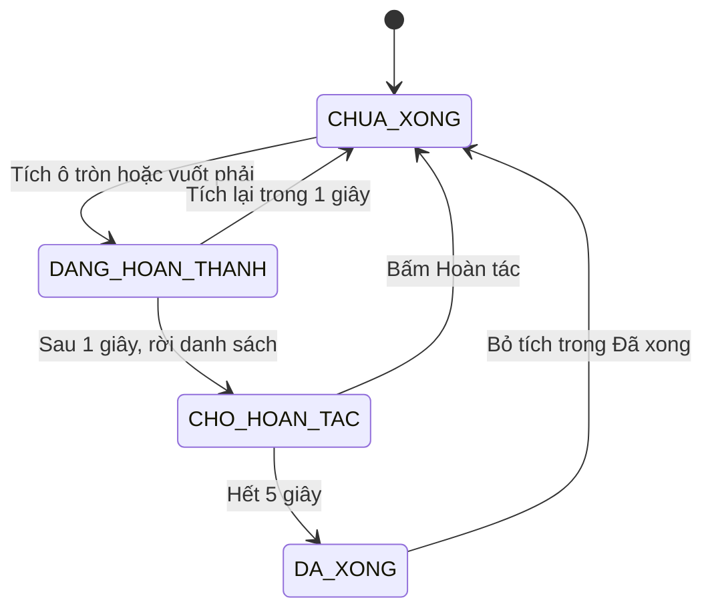
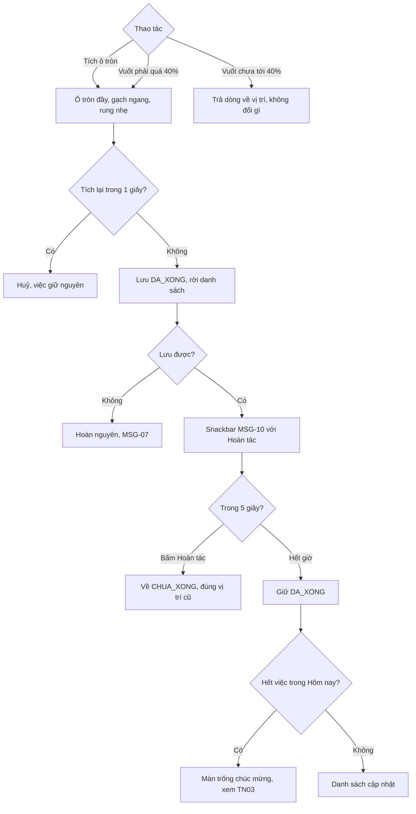
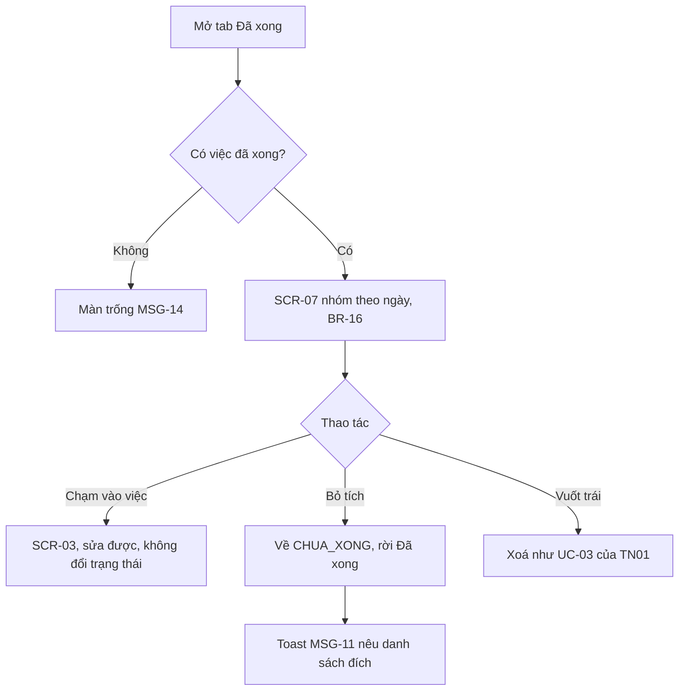
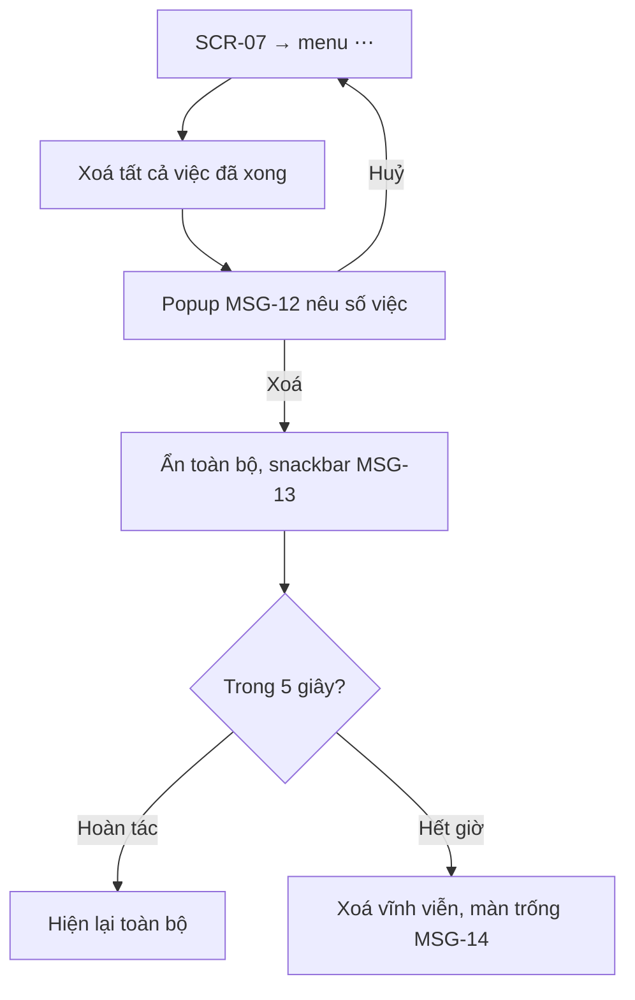
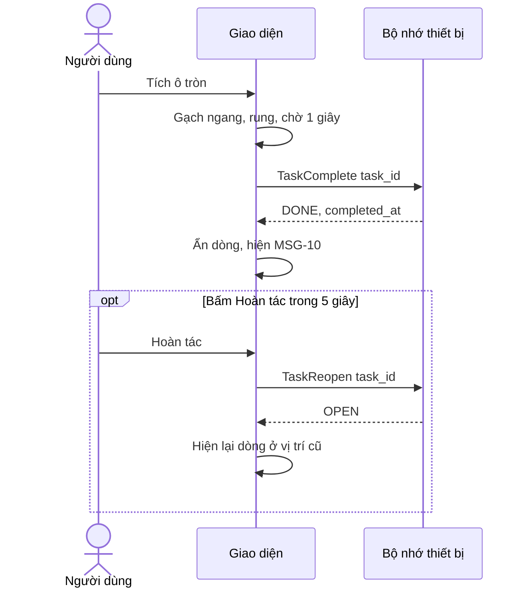

> **Mã:** DE01-TN02-SRS · **Trạng thái:** nháp · **Người viết:** Design (mock) · **PRD:** [PRD.md](PRD.md)

# UC-DE01-02 - Hoàn thành và mở lại việc

> **Bản mock.** Giá trị `[giả định]` cần BA xác nhận. Quy tắc chung về việc (tiêu đề, hạn, nhãn, xoá) giữ theo [SRS TN01](../TN01-quan-ly-task/SRS.md).

## 1. Tổng quan

| **Mục** | **Nội dung** |
| --- | --- |
| Mục tiêu | Người dùng đánh dấu việc xong, hoàn tác khi nhầm, xem lại và mở lại việc đã xong, dọn việc đã xong |
| Actor | Người dùng · Hệ thống (app và bộ nhớ trên thiết bị) |
| Phạm vi | Ô tròn hoàn thành, vuốt phải, tab Đã xong, mở lại, xoá tất cả việc đã xong |
| Ngoài phạm vi | Thống kê năng suất, streak, hoàn thành hàng loạt, tự dọn |
| Nền tảng | App iOS / Android `[giả định]` |
| Figma | `[chưa có]` |

## 2. User Story

| **ID** | **As a** | **I want** | **So that** |
| --- | --- | --- | --- |
| US-06 | Người dùng | Đánh dấu xong ngay trên danh sách | Cập nhật nhanh, danh sách gọn |
| US-07 | Người dùng | Hoàn tác khi tích nhầm | Không mất việc chưa làm |
| US-08 | Người dùng | Xem lại việc đã làm theo ngày | Thấy mình tiến bộ, dễ báo cáo |
| US-09 | Người dùng | Mở lại việc chưa thật xong | Tiếp tục theo dõi việc đó |
| US-10 | Người dùng | Xoá hàng loạt việc đã xong | Dọn danh sách cũ |

## 3. Business Rules

| **Mã** | **Quy tắc** |
| --- | --- |
| BR-12 | Đánh dấu xong bằng: ô tròn trên dòng việc, vuốt phải quá **40%** chiều rộng dòng, hoặc ô tròn ở **SCR-03** `[giả định]` |
| BR-13 | Sau khi tích: ô tròn đầy, tiêu đề gạch ngang, rung nhẹ; việc ở lại danh sách **1 giây** rồi mới rời. Tích lại trong 1 giây này → huỷ, không ghi gì `[giả định]` |
| BR-14 | Việc rời danh sách → lưu `DA_XONG`, ghi completed_at, hiện snackbar MSG-10 với Hoàn tác **5 giây** |
| BR-15 | Hoàn tác hoặc mở lại → `CHUA_XONG`, xoá completed_at; giữ nguyên hạn, ưu tiên, nhãn. Hạn đã qua → hiện như `QUA_HAN` |
| BR-16 | Tab Đã xong sắp xếp theo completed_at giảm dần, nhóm theo ngày: Hôm nay, Hôm qua, {thứ, dd/mm} |
| BR-17 | "Xoá tất cả việc đã xong" xoá mọi việc `DA_XONG`; phải xác nhận (MSG-12), sau đó có Hoàn tác 5 giây (MSG-13) |
| BR-18 | Mỗi lúc chỉ một snackbar; thao tác mới chốt thao tác trước đó (giống BR-09) |

## 4. Trạng thái

### 4.1 Chuyển trạng thái khi hoàn thành

| **Trạng thái** | **Điều kiện** | **Hiển thị** |
| --- | --- | --- |
| `CHUA_XONG` | Việc đang làm | Ô tròn rỗng, viền theo mức ưu tiên |
| `DANG_HOAN_THANH` | Trong 1 giây sau khi tích | Ô tròn đầy, tiêu đề gạch ngang, vẫn ở vị trí cũ |
| `CHO_HOAN_TAC` | Đã rời danh sách, snackbar còn | Đã lưu `DA_XONG`; snackbar MSG-10 |
| `DA_XONG` | Hết thời gian hoàn tác | Chỉ hiện trong tab Đã xong và kết quả tìm kiếm |

`DANG_HOAN_THANH` và `CHO_HOAN_TAC` là trạng thái giao diện, không lưu xuống bộ nhớ.

## 5. Use Case

### UC-05 Đánh dấu hoàn thành

| **Mục** | **Nội dung** |
| --- | --- |
| Tiền điều kiện | Việc ở trạng thái `CHUA_XONG` hoặc `QUA_HAN` |
| Hậu điều kiện thành công | Việc `DA_XONG`, có completed_at, rời danh sách đang làm |
| Hậu điều kiện thất bại | Việc giữ `CHUA_XONG` |

**Luồng chính**

| **Bước** | **Actor** | **Mô tả** |
| --- | --- | --- |
| 1 | Người dùng | Tích ô tròn hoặc vuốt phải trên dòng việc |
| 2 | Hệ thống | Đổi giao diện theo BR-13, rung nhẹ |
| 3 | Hệ thống | Sau 1 giây: lưu `DA_XONG`, ghi completed_at, việc rời danh sách |
| 4 | Hệ thống | Hiện snackbar MSG-10 với Hoàn tác (BR-14) |
| 5 | Hệ thống | Hết 5 giây: ẩn snackbar, cập nhật badge và màn trống nếu cần |

**Luồng thay thế**

| **Mã** | **Điều kiện** | **Xử lý** |
| --- | --- | --- |
| A1 | Tích lại trong 1 giây | Huỷ thao tác, không lưu, không hiện snackbar |
| A2 | Bấm Hoàn tác trong 5 giây | Về `CHUA_XONG`, xoá completed_at, việc về đúng vị trí cũ |
| A3 | Tích ở **SCR-03** | Ở lại **SCR-03**, hiện "Đã hoàn thành lúc {giờ}"; không hiện snackbar vì bỏ tích được ngay tại màn |
| A4 | Việc cuối cùng của Hôm nay | Sau bước 5 hiện màn trống chúc mừng (SRS TN03, MSG-16) |
| A5 | Hoàn thành việc khác khi snackbar còn | Việc trước chốt `DA_XONG`; snackbar mới cho việc sau (BR-18) |

**Luồng lỗi**

| **Mã** | **Điều kiện** | **Xử lý** |
| --- | --- | --- |
| E1 | Lưu thất bại | Hoàn nguyên giao diện về `CHUA_XONG`, hiện MSG-07 |

### UC-06 Xem và mở lại việc đã xong

| **Mục** | **Nội dung** |
| --- | --- |
| Tiền điều kiện | Không có |
| Hậu điều kiện thành công | Việc mở lại về `CHUA_XONG`, hiện lại ở danh sách theo hạn |
| Hậu điều kiện thất bại | Việc giữ `DA_XONG` |

**Luồng chính**

| **Bước** | **Actor** | **Mô tả** |
| --- | --- | --- |
| 1 | Người dùng | Mở tab Đã xong |
| 2 | Hệ thống | Hiện **SCR-07** theo BR-16 |
| 3 | Người dùng | Bỏ tích ô tròn của một việc |
| 4 | Hệ thống | Chuyển `CHUA_XONG` theo BR-15, việc rời **SCR-07**, hiện MSG-11 |

**Luồng thay thế**

| **Mã** | **Điều kiện** | **Xử lý** |
| --- | --- | --- |
| A1 | Chưa có việc nào xong | Màn trống MSG-14 |
| A2 | Chạm vào việc | Mở **SCR-03**; sửa được, không đổi trạng thái |
| A3 | Hạn của việc mở lại đã qua | Việc hiện ở nhóm Quá hạn; MSG-11 nêu "Hôm nay" |

### UC-07 Dọn việc đã xong

| **Mục** | **Nội dung** |
| --- | --- |
| Tiền điều kiện | Có ít nhất 1 việc `DA_XONG` |
| Hậu điều kiện thành công | Mọi việc `DA_XONG` bị xoá vĩnh viễn sau thời gian hoàn tác |
| Hậu điều kiện thất bại | Danh sách Đã xong giữ nguyên |

**Luồng chính**

| **Bước** | **Actor** | **Mô tả** |
| --- | --- | --- |
| 1 | Người dùng | **SCR-07** → menu ⋯ → "Xoá tất cả việc đã xong" |
| 2 | Hệ thống | Hiện MSG-12 với số việc |
| 3 | Người dùng | Bấm Xoá |
| 4 | Hệ thống | Ẩn toàn bộ, hiện MSG-13 với Hoàn tác; hết 5 giây xoá vĩnh viễn (BR-17) |

**Luồng thay thế**

| **Mã** | **Điều kiện** | **Xử lý** |
| --- | --- | --- |
| A1 | Bấm Hoàn tác | Hiện lại toàn bộ việc như trước |
| A2 | Không có việc nào | Mục menu disabled |

## 6. Điểm vào

| **Điểm vào** | **Dẫn tới** | **Ghi chú** |
| --- | --- | --- |
| Ô tròn trên dòng việc (Hôm nay, Sắp tới, Tất cả, Tìm kiếm) | UC-05 | |
| Vuốt phải trên dòng việc | UC-05 | Không áp dụng trong tab Đã xong |
| Ô tròn ở **SCR-03** | UC-05 (A3) hoặc mở lại | |
| Tab "Đã xong" | UC-06, **SCR-07** | |
| Menu ⋯ ở **SCR-07** | UC-07 | |

## 7. Mô tả màn hình

### Dòng việc (thành phần dùng chung trong SCR-01, SCR-07, SCR-09)

| **#** | **Thành phần** | **Loại** | **Hành vi** |
| --- | --- | --- | --- |
| 1 | Ô tròn | Checkbox | Vùng chạm ≥ 44 pt, tách khỏi vùng mở việc; viền theo mức ưu tiên kèm biểu tượng cờ |
| 2 | Tiêu đề | Text | Tối đa 2 dòng, cắt bằng "…" |
| 3 | Dòng phụ | Text + chip | Hạn (đỏ nếu quá hạn), tối đa 3 chip nhãn, biểu tượng ghi chú nếu có |
| 4 | Vuốt phải | Gesture | Nền xanh, chữ "Xong"; quá 40% thì hoàn thành (BR-12) |
| 5 | Vuốt trái | Gesture | Nền đỏ, chữ "Xoá" (SRS TN01) |
| 6 | Chạm vùng còn lại | Gesture | Mở **SCR-03** |

### SCR-07 Đã xong

| **#** | **Thành phần** | **Loại** | **Hành vi** |
| --- | --- | --- | --- |
| 1 | Header | Header | "Đã xong" + menu ⋯ ("Xoá tất cả việc đã xong") |
| 2 | Tiêu đề nhóm | Section header | Hôm nay / Hôm qua / {thứ, dd/mm} + số việc |
| 3 | Dòng việc đã xong | List item | Ô tròn đầy, tiêu đề gạch ngang màu phụ, "Xong lúc {giờ}"; bỏ tích → UC-06 |
| 4 | Màn trống | Empty state | MSG-14 |

## 8. Dữ liệu và thao tác

| **Thao tác** | **Input chính** | **Output chính** | **Ghi chú** |
| --- | --- | --- | --- |
| \[TaskComplete\] | task_id | status = DONE, completed_at | Gọi sau 1 giây (BR-13) |
| \[TaskReopen\] | task_id | status = OPEN, completed_at = rỗng | Hoàn tác hoặc mở lại (BR-15) |
| \[TaskListCompleted\] | – | Danh sách nhóm theo ngày | BR-16, tải dần 50 việc mỗi lần `[giả định]` |
| \[TaskDeleteCompleted\] | – | Số việc đã xoá | Chỉ gọi khi hết thời gian hoàn tác (BR-17) |

## 9. Danh sách thông báo

| **ID** | **Nơi hiện** | **Nội dung (VI)** |
| --- | --- | --- |
| MSG-10 | Snackbar | Đã hoàn thành "{tiêu đề, rút gọn 30 ký tự}" · Hoàn tác |
| MSG-11 | Toast | Đã chuyển về {Hôm nay / Sắp tới / Tất cả} |
| MSG-12 | Popup | Xoá {n} việc đã hoàn thành? Bạn có 5 giây để hoàn tác. \[Huỷ\] \[Xoá\] |
| MSG-13 | Snackbar | Đã xoá {n} việc · Hoàn tác |
| MSG-14 | **SCR-07** | Chưa có việc nào hoàn thành. Việc bạn làm xong sẽ hiện ở đây |

MSG-07 dùng lại từ SRS TN01. Bản EN: `[chờ bổ sung]`.

## 10. Yêu cầu phi chức năng

| **Mục** | **Yêu cầu** `[giả định]` |
| --- | --- |
| Hiệu năng | Phản hồi giao diện khi tích ≤ 100 ms; hiệu ứng 200–300 ms; **SCR-07** mở ≤ 500 ms với 2.000 việc đã xong |
| Chuyển động | Tôn trọng cài đặt giảm chuyển động của hệ thống: bỏ hiệu ứng, giữ thay đổi trạng thái |
| Dữ liệu | Không mất trạng thái khi app bị tắt trong lúc chờ hoàn tác: đã qua 1 giây thì đã lưu `DA_XONG` |
| Bảo mật | Dữ liệu chỉ lưu trên máy, không gửi ra ngoài; nội dung việc không đưa vào sự kiện tracking |
| Log / audit | Ghi trên máy mỗi lần hoàn thành, mở lại, xoá hàng loạt (số việc), hoàn tác, kèm thời điểm |
| Tracking | Hoàn thành (nguồn: ô tròn / vuốt / chi tiết), hoàn tác, mở lại, xoá tất cả (số lượng) |
| Accessibility | Trình đọc màn hình đọc "Đánh dấu hoàn thành {tiêu đề}"; có hành động thay thế cho vuốt; trạng thái xong không chỉ báo bằng màu |
