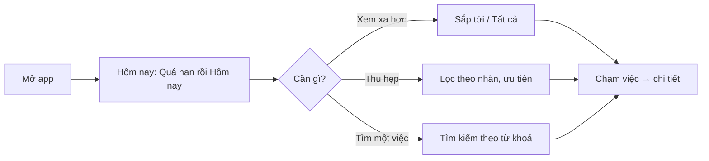

> **Mã:** DE01-TN03-PRD · **Trạng thái:** nháp · **Người viết:** Design (mock) · **SRS:** [SRS.md](SRS.md)

# PRD Xem, lọc và tìm kiếm việc (App quản lý công việc cá nhân)

> **Bản mock.** Con số đánh dấu `[giả định]` dùng để dựng flow, cần PO xác nhận trước khi dùng.

## 1. Bối cảnh và vấn đề

### 1.1 Bối cảnh

Người dùng đã ghi được việc ([TN01](../TN01-quan-ly-task/PRD.md)) và đánh dấu xong ([TN02](../TN02-hoan-thanh-mo-lai/PRD.md)). Phần còn lại là màn hình họ nhìn thấy mỗi lần mở app: hôm nay cần làm gì, sắp tới có gì, và tìm lại một việc cụ thể khi danh sách đã dài.

### 1.2 Vấn đề

| **Vấn đề** | **Hệ quả** |
| --- | --- |
| Mở app thấy toàn bộ danh sách dài | Không biết bắt đầu từ đâu, bỏ sót việc hôm nay |
| Việc quá hạn lẫn với việc khác | Trễ thêm mà không biết |
| Không lọc được theo nhãn, ưu tiên | Freelancer không tách được việc từng khách |
| Không tìm được việc cũ | Phải cuộn tìm, hoặc ghi lại việc trùng |
| Màn trống không nói gì | Người dùng mới không biết làm gì tiếp |

### 1.3 Mục tiêu

- Mở app ≤ 1 giây là thấy việc hôm nay và việc quá hạn `[giả định]`.
- Tìm thấy một việc bất kỳ trong ≤ 10 giây `[giả định]`.
- Người dùng mới tạo được việc đầu tiên từ màn trống.

## 2. Người dùng

| **Nhóm** | **Nhu cầu với tính năng này** |
| --- | --- |
| Người đi làm văn phòng | Sáng mở app thấy việc hôm nay, việc quá hạn nổi lên trên |
| Sinh viên | Xem tuần tới có hạn nộp gì |
| Freelancer | Lọc theo nhãn khách hàng, tìm lại việc cũ theo từ khoá |

## 3. Phạm vi

### 3.1 Trong phạm vi (MVP)

- 3 danh sách: Hôm nay, Sắp tới, Tất cả (tab Đã xong thuộc TN02).
- Nhóm việc theo Quá hạn, theo ngày, Không có hạn.
- Lọc theo nhãn và mức ưu tiên; 3 cách sắp xếp.
- Tìm kiếm theo từ khoá trong tiêu đề, ghi chú, tên nhãn.
- Màn trống cho người dùng mới, khi xong hết việc, khi lọc hoặc tìm không ra.

### 3.2 Ngoài phạm vi

- Xem dạng lịch tháng, dạng bảng Kanban.
- Kéo thả sắp xếp thủ công.
- Lưu bộ lọc thành danh sách riêng.
- Lịch sử tìm kiếm, gợi ý từ khoá.

## 4. Nguyên tắc sản phẩm

### 4.1 Hôm nay là trên hết

App luôn mở vào Hôm nay. Việc quá hạn nằm trên cùng vì đó là việc cần xử lý trước.

### 4.2 Không bắt người dùng tự sắp xếp

Mặc định sắp theo hạn rồi theo ưu tiên. Người dùng không phải kéo thả để danh sách có thứ tự.

### 4.3 Luôn biết mình đang lọc gì

Khi có bộ lọc, chip bộ lọc luôn hiện trên đầu danh sách. Người dùng không bao giờ tưởng mất việc vì quên đang lọc.

### 4.4 Màn trống có việc để làm

Mỗi màn trống nói rõ vì sao trống và đưa ra đúng một hành động tiếp theo.

## 5. Quy tắc nghiệp vụ

| **Quy tắc** | **Giá trị** `[giả định]` |
| --- | --- |
| Hôm nay | Việc chưa xong có hạn hôm nay hoặc đã quá hạn |
| Sắp tới | Việc chưa xong có hạn từ ngày mai; nhóm theo ngày trong 7 ngày, sau đó là "Sau này" |
| Tất cả | Mọi việc chưa xong: Quá hạn, Có hạn, Không có hạn |
| Sắp xếp mặc định | Theo hạn tăng dần → ưu tiên cao trước → tạo trước |
| Lọc | Trong cùng loại là HOẶC, giữa nhãn và ưu tiên là VÀ |
| Tìm kiếm | Tiêu đề, ghi chú, tên nhãn; không phân biệt hoa thường và dấu; chờ 300 ms sau lần gõ cuối |
| Badge tab Hôm nay | Số việc trong Hôm nay, tối đa hiện "99+" |

- Các giá trị trên là **cấu hình**, không cố định trong code.

## 6. Luồng trải nghiệm

| **Bước** | **Giai đoạn** | **Trải nghiệm** | **Đầu ra** |
| --- | --- | --- | --- |
| 1 | Mở app | Vào Hôm nay; người dùng mới thấy màn trống hướng dẫn | Biết việc hôm nay |
| 2 | Xem xa hơn | Chuyển tab Sắp tới hoặc Tất cả | Biết việc sắp đến |
| 3 | Thu hẹp | Bấm Lọc, chọn nhãn và ưu tiên; chip hiện trên đầu | Danh sách đã lọc |
| 4 | Đổi thứ tự | Chọn cách sắp xếp | Danh sách theo thứ tự mới |
| 5 | Tìm | Bấm Tìm, gõ từ khoá; kết quả hiện khi đang gõ | Việc cần tìm |
| 6 | Mở việc | Chạm kết quả → màn chi tiết | Xem hoặc sửa việc |

## 7. Use Cases, User Stories và Acceptance Criteria

### UC1. Xem danh sách

#### US1.1 Xem việc hôm nay

User Story: Là người dùng, tôi muốn mở app là biết ngay hôm nay cần làm gì.

AC01: Mở app vào Hôm nay: nhóm Quá hạn ở trên (nếu có), rồi nhóm Hôm nay.

AC02: Tab Hôm nay có badge số việc chưa xong, kể cả quá hạn.

AC03: Hết việc → màn trống chúc mừng kèm nút thêm việc; người dùng mới → màn trống hướng dẫn tạo việc đầu tiên.

AC04: Qua 00:00 khi app đang mở → danh sách tự tính lại.

#### US1.2 Xem việc sắp tới và tất cả việc

User Story: Là người dùng, tôi muốn xem việc sắp tới theo ngày và toàn bộ việc để chuẩn bị trước.

AC01: Sắp tới nhóm theo từng ngày trong 7 ngày tới, sau đó là nhóm Sau này.

AC02: Tất cả gồm cả việc không có hạn, nhóm: Quá hạn, Có hạn, Không có hạn.

AC03: Mỗi tiêu đề nhóm có số việc; nhóm rỗng không hiện.

### UC2. Lọc và sắp xếp

#### US2.1 Lọc theo nhãn và ưu tiên

User Story: Là freelancer, tôi muốn lọc theo nhãn khách hàng để chỉ thấy việc của khách đó.

AC01: Lọc theo nhãn và theo mức ưu tiên, chọn được nhiều giá trị.

AC02: Khi đang lọc, chip bộ lọc luôn hiện trên đầu danh sách kèm "Xoá lọc".

AC03: Lọc không ra việc nào → màn trống nói rõ do bộ lọc, có nút Xoá lọc.

AC04: Bộ lọc được nhớ riêng cho từng danh sách, kể cả khi đóng app.

#### US2.2 Sắp xếp

User Story: Là người dùng, tôi muốn đổi cách sắp xếp danh sách để xem việc theo thứ tự phù hợp.

AC01: Sắp xếp: Theo hạn (mặc định), Theo ưu tiên, Mới tạo trước.

AC02: Chọn cách khác Theo hạn thì bỏ nhóm theo ngày, chỉ giữ nhóm Quá hạn.

### UC3. Tìm kiếm

#### US3.1 Tìm việc theo từ khoá

User Story: Là người dùng, tôi muốn tìm việc theo từ khoá để không phải cuộn cả danh sách.

AC01: Tìm trong tiêu đề, ghi chú và tên nhãn; không phân biệt hoa thường, có dấu hay không dấu.

AC02: Kết quả cập nhật khi đang gõ, gồm cả việc đã xong và tách thành nhóm riêng.

AC03: Từ khoá khớp được tô đậm trong kết quả.

AC04: Không có kết quả → nói rõ không tìm thấy, gợi ý kiểm tra từ khoá.

## 8. Chỉ số theo dõi `[giả định]`

| **Chỉ số** | **Định nghĩa** | **Mục tiêu MVP** |
| --- | --- | --- |
| Tỉ lệ kích hoạt | Người dùng mới tạo ≥ 1 việc từ màn trống / người dùng mới | ≥ 70% |
| Thời gian mở app | Từ chạm icon đến khi danh sách hiện | ≤ 1 giây (p95) |
| Tỉ lệ dùng lọc | Người dùng có lọc ≥ 1 lần mỗi tuần / người dùng hoạt động | Theo dõi |
| Tỉ lệ tìm thấy | Phiên tìm kiếm có chạm vào kết quả / tổng phiên tìm | ≥ 60% |
| Tỉ lệ tìm không ra | Phiên tìm kiếm kết thúc ở màn trống / tổng phiên tìm | ≤ 20% |
| Phân bố tab | Lượt xem Hôm nay, Sắp tới, Tất cả | Theo dõi |

## 9. Phụ thuộc và rủi ro

| **Mục** | **Mô tả** | **Hướng xử lý** |
| --- | --- | --- |
| Quên đang lọc | Người dùng tưởng mất việc | Chip bộ lọc luôn hiện, màn trống nói rõ lý do |
| Danh sách dài | Cuộn giật, tìm chậm | Kiểm thử với 2.000 việc, tải dần |
| Qua ngày mới | Danh sách Hôm nay sai nếu app mở qua đêm | Tính lại khi qua 00:00 và khi app trở lại nền trước |
| Tìm tiếng Việt | Người dùng gõ không dấu | So khớp sau khi bỏ dấu ở cả hai phía |
| Nhiều việc quá hạn | Hôm nay bị lấp bởi việc cũ | Nhóm Quá hạn thu gọn được `[cần chốt]` |

## 10. Câu hỏi mở

- Nhóm Quá hạn có thu gọn được không, có giới hạn số việc hiển thị không?
- Sắp tới hiện 7 ngày hay 14 ngày?
- Tìm kiếm có cần lọc kèm (nhãn, trạng thái) ở MVP không?
- Bộ lọc có nên áp dụng chung cho mọi danh sách thay vì nhớ riêng?
