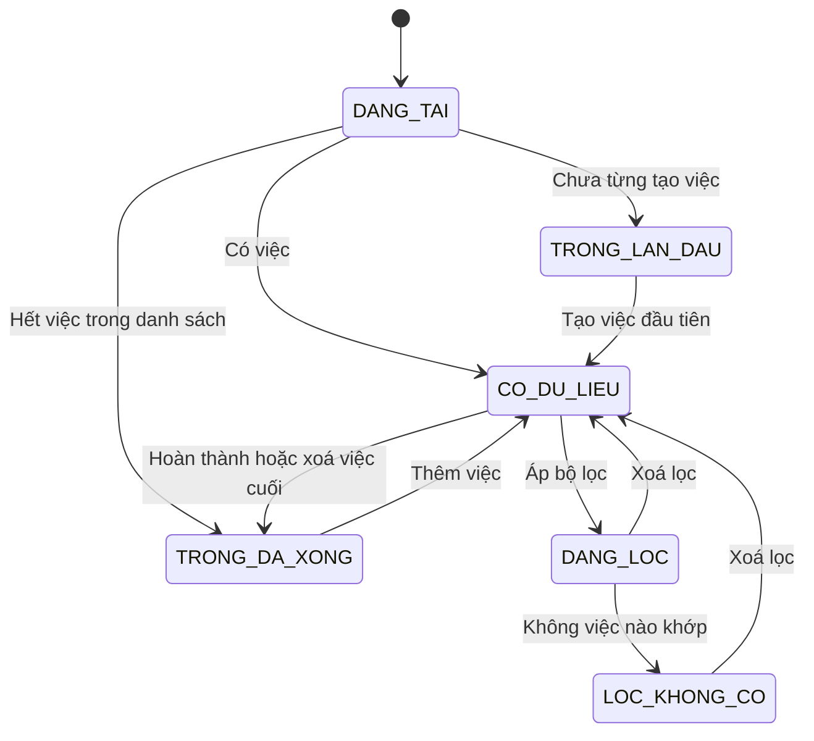
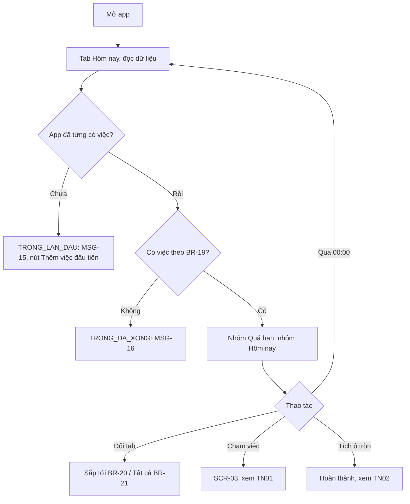
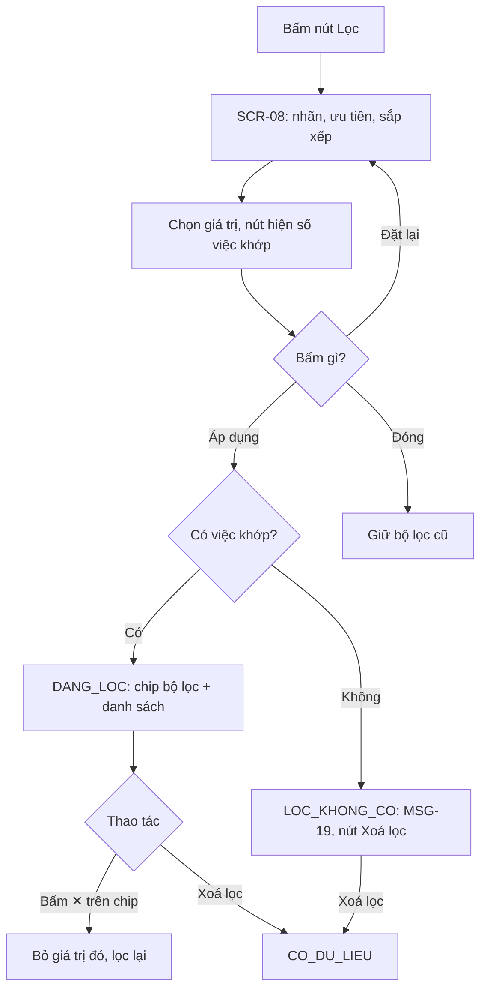
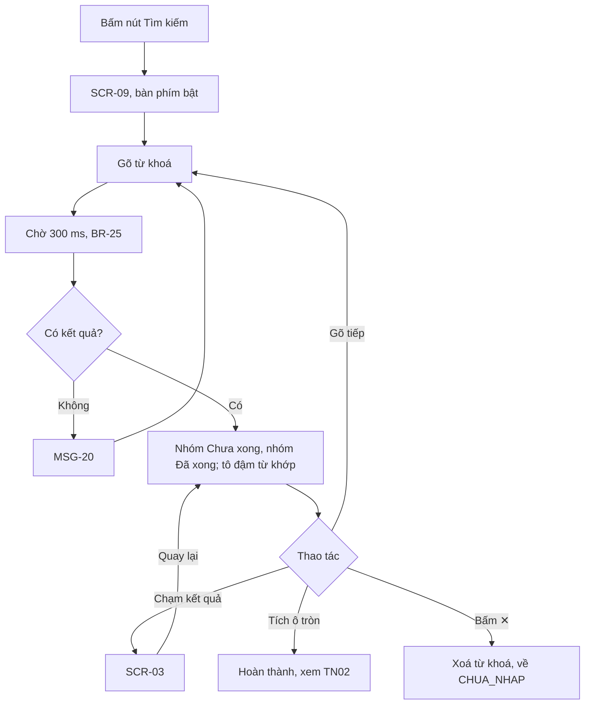
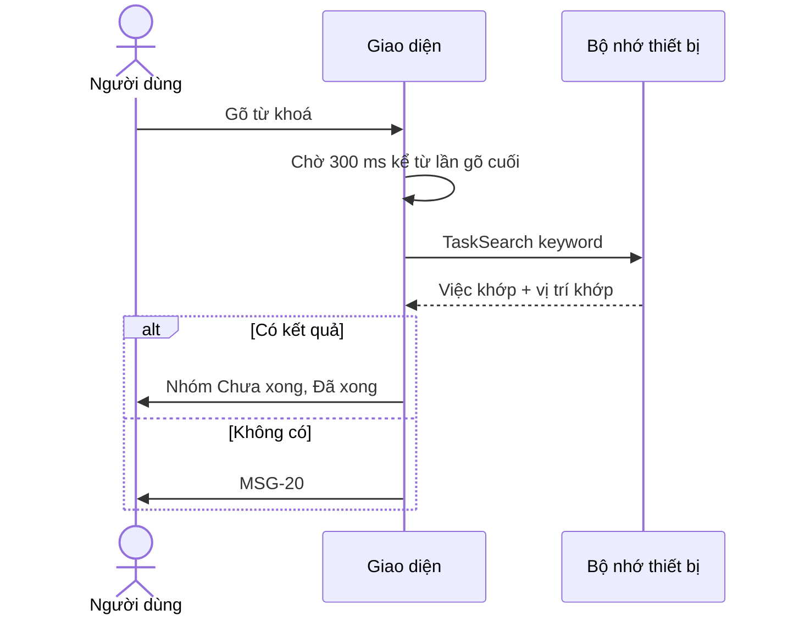

> **Mã:** DE01-TN03-SRS · **Trạng thái:** nháp · **Người viết:** Design (mock) · **PRD:** [PRD.md](PRD.md)

# UC-DE01-03 - Xem, lọc và tìm kiếm việc

> **Bản mock.** Giá trị `[giả định]` cần BA xác nhận. Dòng việc (task row) và thao tác hoàn thành xem [SRS TN02](../TN02-hoan-thanh-mo-lai/SRS.md); tạo, sửa, xoá xem [SRS TN01](../TN01-quan-ly-task/SRS.md).

## 1. Tổng quan

| **Mục** | **Nội dung** |
| --- | --- |
| Mục tiêu | Người dùng thấy việc cần làm theo ngày, thu hẹp bằng bộ lọc, tìm lại việc bằng từ khoá |
| Actor | Người dùng · Hệ thống (app và bộ nhớ trên thiết bị) |
| Phạm vi | Danh sách Hôm nay, Sắp tới, Tất cả; lọc; sắp xếp; tìm kiếm; các màn trống |
| Ngoài phạm vi | Xem dạng lịch, Kanban, kéo thả sắp xếp, lưu bộ lọc, lịch sử tìm kiếm |
| Nền tảng | App iOS / Android `[giả định]` |
| Figma | `[chưa có]` |

## 2. User Story

| **ID** | **As a** | **I want** | **So that** |
| --- | --- | --- | --- |
| US-11 | Người dùng | Mở app thấy việc hôm nay và việc quá hạn | Biết làm gì trước |
| US-12 | Người dùng | Xem việc sắp tới theo ngày | Chuẩn bị trước |
| US-13 | Người dùng | Lọc theo nhãn và ưu tiên | Chỉ thấy việc đang quan tâm |
| US-14 | Người dùng | Đổi cách sắp xếp | Xem theo thứ tự phù hợp |
| US-15 | Người dùng | Tìm việc theo từ khoá | Không phải cuộn cả danh sách |

## 3. Business Rules

| **Mã** | **Quy tắc** |
| --- | --- |
| BR-19 | **Hôm nay** = việc `CHUA_XONG` có hạn ≤ cuối ngày hôm nay. Nhóm: Quá hạn (hạn < hiện tại), Hôm nay |
| BR-20 | **Sắp tới** = việc `CHUA_XONG` có hạn từ ngày mai. Nhóm theo từng ngày trong 7 ngày, còn lại vào "Sau này" `[giả định]` |
| BR-21 | **Tất cả** = mọi việc `CHUA_XONG`. Nhóm: Quá hạn, Có hạn, Không có hạn |
| BR-22 | **Sắp xếp mặc định** (Theo hạn): hạn tăng dần → ưu tiên Cao trước → tạo trước. Việc có giờ đứng trước việc không có giờ trong cùng ngày |
| BR-23 | Sắp xếp khác: Theo ưu tiên (Cao → Không, rồi theo hạn), Mới tạo trước. Khi dùng, bỏ nhóm theo ngày, giữ nhóm Quá hạn |
| BR-24 | **Lọc**: nhiều nhãn là HOẶC, nhiều mức ưu tiên là HOẶC, giữa nhãn và ưu tiên là VÀ. Bộ lọc và cách sắp xếp nhớ riêng từng danh sách |
| BR-25 | **Tìm kiếm** trong tiêu đề, ghi chú, tên nhãn; bỏ dấu và hoa thường ở cả hai phía; chạy sau 300 ms kể từ lần gõ cuối; từ khoá tối thiểu 1 ký tự `[giả định]` |
| BR-26 | Kết quả tìm: nhóm "Chưa xong" trước, "Đã xong" sau; trong nhóm sắp theo BR-22; không áp dụng bộ lọc của danh sách |
| BR-27 | Danh sách tính lại khi: qua 00:00, app trở lại nền trước, có thay đổi dữ liệu. Badge Hôm nay = số việc theo BR-19, tối đa "99+" |

## 4. Trạng thái

### 4.1 Trạng thái màn danh sách

| **Trạng thái** | **Điều kiện** | **Hiển thị** |
| --- | --- | --- |
| `DANG_TAI` | Đang đọc dữ liệu | Skeleton 3 dòng; chỉ hiện nếu quá 300 ms |
| `TRONG_LAN_DAU` | App chưa từng có việc nào | MSG-15 + nút "Thêm việc đầu tiên" |
| `TRONG_DA_XONG` | Danh sách không còn việc, đã từng có | Hôm nay: MSG-16; Sắp tới: MSG-17; Tất cả: MSG-18 |
| `CO_DU_LIEU` | Có ≥ 1 việc | Danh sách theo nhóm |
| `DANG_LOC` | Có bộ lọc, còn việc khớp | Thanh chip bộ lọc + danh sách |
| `LOC_KHONG_CO` | Có bộ lọc, không việc nào khớp | MSG-19 + nút "Xoá lọc" |

### 4.2 Trạng thái màn tìm kiếm

`CHUA_NHAP` (gợi ý "Gõ để tìm") → `DANG_TIM` → `CO_KET_QUA` hoặc `KHONG_CO_KET_QUA` (MSG-20).

## 5. Use Case

### UC-08 Xem danh sách việc

| **Mục** | **Nội dung** |
| --- | --- |
| Tiền điều kiện | Không có |
| Hậu điều kiện thành công | Danh sách hiện đúng theo BR-19–22 |
| Hậu điều kiện thất bại | Hiện thông báo lỗi đọc dữ liệu, có nút Thử lại |

**Luồng chính**

| **Bước** | **Actor** | **Mô tả** |
| --- | --- | --- |
| 1 | Người dùng | Mở app |
| 2 | Hệ thống | Mở **SCR-01** ở tab Hôm nay, đọc việc theo BR-19 |
| 3 | Hệ thống | Hiện nhóm Quá hạn (nếu có), nhóm Hôm nay; cập nhật badge (BR-27) |
| 4 | Người dùng | Cuộn, chuyển tab Sắp tới hoặc Tất cả |
| 5 | Hệ thống | Hiện danh sách theo BR-20 hoặc BR-21, áp bộ lọc đã nhớ của tab đó |

**Luồng thay thế**

| **Mã** | **Điều kiện** | **Xử lý** |
| --- | --- | --- |
| A1 | Chưa từng có việc | `TRONG_LAN_DAU`: MSG-15, nút mở **SCR-02** |
| A2 | Danh sách hết việc | `TRONG_DA_XONG` theo tab (MSG-16, 17, 18) |
| A3 | Qua 00:00 hoặc app trở lại nền trước | Tính lại danh sách, giữ vị trí cuộn nếu được (BR-27) |
| A4 | Tab có bộ lọc đã nhớ | Hiện thanh chip bộ lọc ngay khi vào tab |

**Luồng lỗi**

| **Mã** | **Điều kiện** | **Xử lý** |
| --- | --- | --- |
| E1 | Đọc dữ liệu thất bại | Màn lỗi "Không tải được danh sách" + nút Thử lại |

### UC-09 Lọc và sắp xếp

| **Mục** | **Nội dung** |
| --- | --- |
| Tiền điều kiện | Đang ở Hôm nay, Sắp tới hoặc Tất cả |
| Hậu điều kiện thành công | Danh sách chỉ còn việc khớp; bộ lọc được nhớ cho tab |
| Hậu điều kiện thất bại | Danh sách giữ như trước |

**Luồng chính**

| **Bước** | **Actor** | **Mô tả** |
| --- | --- | --- |
| 1 | Người dùng | Bấm nút Lọc ở header |
| 2 | Hệ thống | Mở **SCR-08** với giá trị đang áp dụng |
| 3 | Người dùng | Chọn nhãn, mức ưu tiên, cách sắp xếp |
| 4 | Hệ thống | Cập nhật số việc khớp trên nút "Xem {n} việc" |
| 5 | Người dùng | Bấm "Xem {n} việc" |
| 6 | Hệ thống | Đóng **SCR-08**, hiện thanh chip, lọc danh sách theo BR-24, lưu bộ lọc cho tab |

**Luồng thay thế**

| **Mã** | **Điều kiện** | **Xử lý** |
| --- | --- | --- |
| A1 | Bấm ✕ trên một chip | Bỏ giá trị đó, lọc lại ngay |
| A2 | Bấm "Xoá lọc" | Bỏ mọi bộ lọc; cách sắp xếp giữ nguyên |
| A3 | Không việc nào khớp | `LOC_KHONG_CO`: MSG-19 |
| A4 | Tạo việc khi đang lọc theo nhãn | Việc mới gán sẵn nhãn đó (BR-06) |
| A5 | Chưa có nhãn nào | Mục Nhãn trong **SCR-08** hiện "Chưa có nhãn" |

### UC-10 Tìm kiếm

| **Mục** | **Nội dung** |
| --- | --- |
| Tiền điều kiện | Không có |
| Hậu điều kiện thành công | Người dùng mở được việc cần tìm |
| Hậu điều kiện thất bại | Hiện màn không có kết quả |

**Luồng chính**

| **Bước** | **Actor** | **Mô tả** |
| --- | --- | --- |
| 1 | Người dùng | Bấm nút Tìm kiếm ở header |
| 2 | Hệ thống | Mở **SCR-09**, bật bàn phím |
| 3 | Người dùng | Gõ từ khoá |
| 4 | Hệ thống | Sau 300 ms, tìm theo BR-25, hiện kết quả theo BR-26, tô đậm phần khớp |
| 5 | Người dùng | Chạm một kết quả |
| 6 | Hệ thống | Mở **SCR-03**; quay lại thì giữ nguyên từ khoá và vị trí cuộn |

**Luồng thay thế**

| **Mã** | **Điều kiện** | **Xử lý** |
| --- | --- | --- |
| A1 | Không có kết quả | MSG-20 |
| A2 | Khớp ở ghi chú hoặc nhãn, không khớp tiêu đề | Dòng phụ hiện đoạn ghi chú hoặc chip nhãn có phần khớp |
| A3 | Xoá hết từ khoá | Về `CHUA_NHAP` |
| A4 | Sửa hoặc hoàn thành việc từ kết quả | Kết quả cập nhật tại chỗ |

## 6. Điểm vào

| **Điểm vào** | **Dẫn tới** | **Ghi chú** |
| --- | --- | --- |
| Mở app | UC-08, tab Hôm nay | Luôn vào Hôm nay, không nhớ tab lần trước `[giả định]` |
| Tab bar | UC-08 | Hôm nay · Sắp tới · Tất cả · Đã xong (TN02) |
| Nút Lọc ở header | UC-09, **SCR-08** | Có chấm báo khi đang lọc |
| Nút Tìm kiếm ở header | UC-10, **SCR-09** | |
| Nút "Xem" trên MSG-03 | UC-08 | Mở tab chứa việc vừa tạo, cuộn tới việc đó |

## 7. Mô tả màn hình

### SCR-01 Danh sách việc

| **#** | **Thành phần** | **Loại** | **Hành vi** |
| --- | --- | --- | --- |
| 1 | Header | Header | Tên tab + ngày hôm nay (ở Hôm nay); nút Tìm kiếm, Lọc, Cài đặt |
| 2 | Thanh chip bộ lọc | Chips | Chỉ hiện khi `DANG_LOC` hoặc `LOC_KHONG_CO`; mỗi chip có ✕; cuối thanh là "Xoá lọc" |
| 3 | Tiêu đề nhóm | Section header | Tên nhóm + số việc; nhóm Quá hạn chữ đỏ kèm biểu tượng |
| 4 | Dòng việc | List item | Thành phần dùng chung, mô tả ở SRS TN02 |
| 5 | Nút "+" | FAB | Mở **SCR-02** (SRS TN01); luôn nổi trên danh sách |
| 6 | Màn trống | Empty state | Theo trạng thái mục 4.1 |
| 7 | Tab bar | Tabs | Hôm nay (có badge), Sắp tới, Tất cả, Đã xong |

### SCR-08 Bộ lọc & sắp xếp (bottom sheet)

| **#** | **Thành phần** | **Loại** | **Hành vi** |
| --- | --- | --- | --- |
| 1 | Nhãn | Chip chọn nhiều | Mọi nhãn hiện có; chưa có nhãn → "Chưa có nhãn" |
| 2 | Ưu tiên | Chip chọn nhiều | Cao, Trung bình, Thấp, Không |
| 3 | Sắp xếp | Radio | Theo hạn (mặc định), Theo ưu tiên, Mới tạo trước |
| 4 | Đặt lại | Button text | Bỏ chọn nhãn và ưu tiên, sắp xếp về mặc định |
| 5 | "Xem {n} việc" | Button | n cập nhật theo lựa chọn; n = 0 vẫn bấm được |

### SCR-09 Tìm kiếm

| **#** | **Thành phần** | **Loại** | **Hành vi** |
| --- | --- | --- | --- |
| 1 | Ô tìm kiếm | Text | Placeholder "Tìm việc, ghi chú, nhãn"; nút ✕ xoá từ khoá; nút Huỷ đóng màn |
| 2 | Gợi ý ban đầu | Text phụ | "Gõ để tìm trong tất cả việc, kể cả việc đã xong" |
| 3 | Nhóm "Chưa xong" | Section + list | Dòng việc dùng chung; tô đậm phần khớp |
| 4 | Nhóm "Đã xong" | Section + list | Dòng việc đã xong (SRS TN02) |
| 5 | Không có kết quả | Empty state | MSG-20 |

## 8. Dữ liệu và thao tác

| **Thao tác** | **Input chính** | **Output chính** | **Ghi chú** |
| --- | --- | --- | --- |
| \[TaskList\] | view (TODAY, UPCOMING, ALL), filter, sort | Việc theo nhóm, số việc mỗi nhóm | BR-19–24 |
| \[TaskCount\] | view, filter | Số việc khớp | Dùng cho badge và nút "Xem {n} việc" |
| \[TaskSearch\] | keyword | Việc khớp, vị trí khớp | BR-25, BR-26 |
| \[ViewPrefSave\] | view, filter, sort | – | Nhớ bộ lọc theo tab (BR-24) |

**Mô hình dữ liệu bổ sung**

| **Đối tượng** | **Trường** |
| --- | --- |
| ViewPref | view, label_ids, priorities, sort |
| Task (bổ sung) | title_normalized, note_normalized (đã bỏ dấu, viết thường, dùng cho tìm kiếm) |

## 9. Danh sách thông báo

| **ID** | **Nơi hiện** | **Nội dung (VI)** |
| --- | --- | --- |
| MSG-15 | **SCR-01** `TRONG_LAN_DAU` | Bắt đầu bằng một việc nhỏ. Ghi lại việc bạn cần làm hôm nay. \[Thêm việc đầu tiên\] |
| MSG-16 | **SCR-01** Hôm nay | Bạn đã xong hết việc hôm nay! \[Thêm việc\] |
| MSG-17 | **SCR-01** Sắp tới | Chưa có việc nào sắp tới. \[Thêm việc\] |
| MSG-18 | **SCR-01** Tất cả | Không còn việc nào đang chờ. \[Thêm việc\] |
| MSG-19 | **SCR-01** `LOC_KHONG_CO` | Không có việc nào khớp bộ lọc. \[Xoá lọc\] |
| MSG-20 | **SCR-09** | Không tìm thấy việc nào cho "{từ khoá}". Thử từ khoá khác hoặc kiểm tra chính tả |

Bản EN: `[chờ bổ sung]`.

## 10. Yêu cầu phi chức năng

| **Mục** | **Yêu cầu** `[giả định]` |
| --- | --- |
| Hiệu năng | Mở app đến khi hiện danh sách ≤ 1 giây (p95) với 2.000 việc; kết quả tìm ≤ 300 ms sau thời gian chờ; cuộn 60 khung hình/giây |
| Offline | Toàn bộ chức năng chạy không cần mạng |
| Dữ liệu | Bộ lọc và cách sắp xếp giữ qua các lần mở app |
| Quyền riêng tư | Không gửi từ khoá tìm kiếm ra ngoài; analytics chỉ ghi có tìm và có kết quả hay không |
| Tracking | Xem tab, áp bộ lọc (loại, số giá trị), đổi sắp xếp, tìm (có / không kết quả), chạm kết quả, bấm nút ở màn trống |
| Accessibility | Tiêu đề nhóm là heading cho trình đọc màn hình; badge được đọc thành "{n} việc hôm nay"; nhóm Quá hạn không chỉ phân biệt bằng màu; hỗ trợ cỡ chữ hệ thống |
